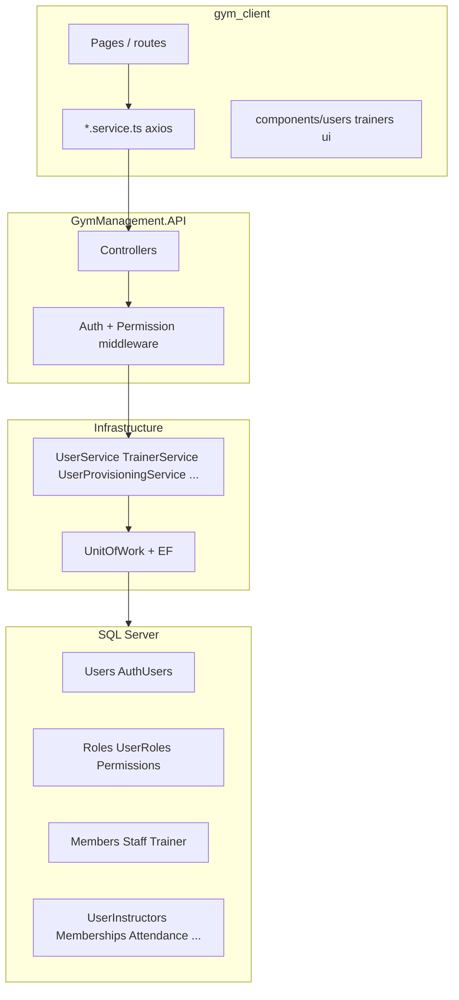
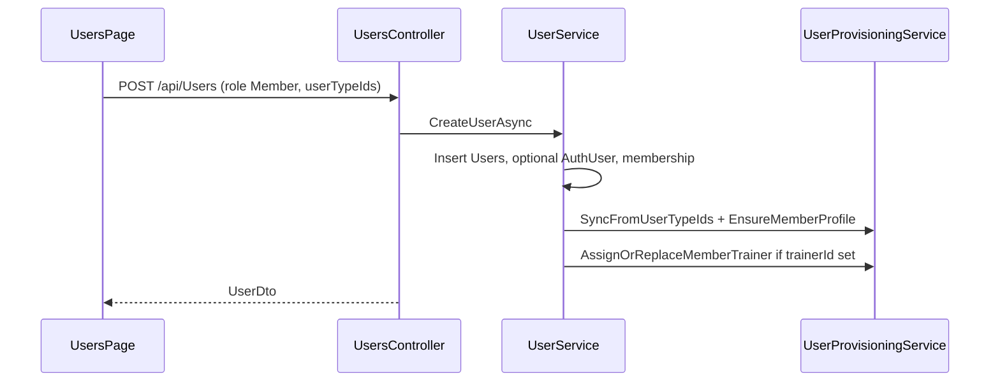
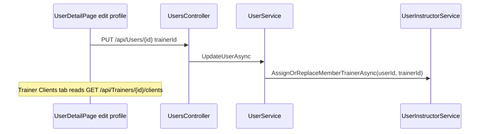

# Application flows & product model

**Purpose:** Single source of truth for how the Gym Management app works end-to-end. Use this before adding features so we extend existing flows instead of duplicating logic.

**Related docs:**

| Doc | Contents |
|-----|----------|
| [CodeWorkflow.md](../CodeWorkflow.md) | HTTP pipeline, JWT, RBAC middleware |
| [USER_ROLE_ARCHITECTURE.md](./USER_ROLE_ARCHITECTURE.md) | Roles, profiles (`Members`, `Staff`, `Trainers`), provisioning |
| [PT_MODULE.md](../PT_MODULE.md) | Personal training packages & sessions |
| [USER_GUIDE.md](../USER_GUIDE.md) | End-user operations |
| [README.md](./README.md) | Knowledge-base index |

**Last updated:** 2026-10-12 (member profile workout history; unified membership/payment history; admin dashboard layout; neutral light theme).

**Section map:** [README.md](./README.md#application_flows-section-map). Scheduled work / evidence labels: [PRODUCT_BACKLOG.md](../PRODUCT_BACKLOG.md).

---

## 1. Stack (actual repo)

| Layer | Technology |
|-------|------------|
| Frontend | React **19** + TypeScript + Vite + **TanStack Query** (`gym_client/package.json`) |
| Mobile | Flutter (`mobile app/`, PulseFit / Tiger Fitness) |
| API | ASP.NET Core **9** (`net9.0` in `src/GymManagement.*.csproj`) |
| Data | EF Core + **SQL Server** (`GymManagementDb`) |
| Auth | JWT + refresh token on `AuthUsers` |

**Mobile API host:** compile-time `--dart-define=API_BASE_URL=…` (no `/api` suffix). Default in `AppConfig` is **`https://tigerfitness.tech`**. UAT: **`https://uat.tigerfitness.tech`**. Local LAN/emulator may use `http://`. PR CI runs `flutter analyze` and `flutter test`. Production APKs require HTTPS plus Android upload-keystore secrets. Details: [mobile app/README.md](../../mobile%20app/README.md), [RELEASE_PROCESS.md](../RELEASE_PROCESS.md).

Do **not** assume Node/PostgreSQL/Prisma unless starting a new service.

---

## 2. High-level architecture



---

## 3. Identity model (critical)

One **person** = one row in `Users`. Login = `AuthUsers` (email, password) → `UserId`.

| Concept | Table / API | UI label |
|---------|-----------|----------|
| **RBAC role** | `Roles` + `UserRoles` | **Source of truth** — edit via application role chips (`POST/DELETE /api/Roles/users/{id}/roles` or user edit profile) |
| **Legacy label** | `UserTypes` + `UserUserTypes` | **Read-only mirror** of roles for older APIs; updated by `SyncUserTypesFromRolesAsync` |
| **Member profile** | `Members` (1:1 `UserId`) | Gym member fields |
| **Trainer profile** | `Trainer` (1:1 `UserId`) | Specialization, rates, employee code |
| **Staff profile** | `Staff` (1:1 `UserId`) | Department, employee code |
| **Coach assignment** | `UserInstructors` | “Personal coach” on member — **not** the Trainer role |

### Common mistake

| User action | Wrong expectation | Correct behavior |
|-------------|-----------------|------------------|
| Check user type **Trainer** on a member | Shows on trainer **Clients** tab | Only creates staff trainer profile; assign coach via **Personal coach** dropdown |
| Member missing **MEMBER** role | Missing from **Users → Members** list | Members list filters `UserRoles` containing **MEMBER** (legacy `UserTypes` kept in sync automatically) |

### Provisioning entry point

**`IUserProvisioningService`** (`UserProvisioningService.cs`):

- `AssignRoleAsync` / `RevokeRoleAsync`
- `EnsureMemberProfileAsync` / `EnsureTrainerProfileAsync` / `EnsureStaffProfileAsync`
- `SyncFromUserTypeIdsAsync` — legacy API path: maps UserTypes → Roles + profiles
- `SyncFromRoleCodesAsync` — roles-first path
- `SyncUserTypesFromRolesAsync` — mirrors active roles onto legacy UserTypes

`UserService` create/update/delete should call provisioning — do not create `Trainer` rows in random controllers.

---

## 4. Frontend routes (dashboard)

**Member billing navigation (2026-10-12):** Member profiles have one **Membership & Payments** tab (`?tab=billing`), with **Memberships & access** followed by **Payments & receipts**. It reuses `MemberMembershipManagePanel` and `MemberPaymentHistoryTab`, omitting the latter's duplicate member header while retaining financial summaries, invoices, receipt actions, and expandable transaction timelines. Legacy `tab=payment-history`, `payments`, `membership-history`, `membership`, and `memberships` links select the combined tab; selecting it writes the canonical `billing` parameter and preserves `mode=view`. Existing membership actions and Payments permission checks remain in their shared components. Paying an outstanding balance is separate from extending gym access.

| Route | Page | Primary API |
|-------|------|-------------|
| `/dashboard/users` | **Grid-first** members directory with compact header + summary strip; light page scroll + tall grid panel (`min-height` ~viewport) | `GET /api/Users/paged?membersOnly=true` (+ `assignedToCoachOnly=true` when coach-scoped) |
| `/dashboard/users/:id` | Member detail | `GET /api/Users/{id}` + deferred `GET /api/Users/{id}/profile-summary`; **Details** tab includes locker allocation via `GET /api/locker-management/assignments/by-user/{userId}` (locker #, locker status, assignment date/status); **Trainer** tab reads `GET /api/UserInstructors/user/{userId}` for current coach, assignment history, and notes |
| `/dashboard/trainers` | Trainers list | `GET /api/Trainers` |
| `/dashboard/trainers/:id` | Trainer detail | `GET /api/Trainers/{id}`, tabs: Clients, Schedule, … |
| `/dashboard/trainers/:id?mode=edit` | Opens edit modal | |

Auth: token in client storage; permissions gate menu items (`PermissionCodes`).

**Dashboard appearance:** the sun/moon button in `TopNavbar` switches Light / Dark on desktop and mobile for every persona. Dark is the initial default. The preference is stored in `AuthUsers.Theme` (migration `AddAccountThemePreference`) and follows the login account across browsers/devices. Authenticated `GET /api/Auth/preferences` reads `{ theme }`; `PUT /api/Auth/preferences` accepts only `light` or `dark` and saves it for the JWT account. No additional permission is required. A per-account `gym-dashboard-theme:<email>` browser cache restores the palette before rendering and synchronizes open tabs. The API hydrates the saved preference when entering the dashboard; toggling updates immediately, disables the switch while saving, and shows a message if persistence fails while retaining the local selection. `lib/dashboardTheme.ts` owns this state; `dashboardTheme.css` supplies the shared light palette for the dashboard shell, existing cards, forms, dialogs and chart labels. Light mode uses a neutral grey canvas (#F5F7FA), white content panels, stronger neutral form borders, and subtle dividers/shadows; dashboard background orbs are hidden. Member profile tabs use blue text and an underline, and collapsed onboarding uses compact next-action and billing accents. Workout History shows a concise empty state and keyboard/touch-accessible sync information disclosure. These appearance overrides are scoped to light mode; dark styling and public marketing pages retain their brand appearance. Keyboard users get a **Skip to main content** link (first tab stop in `DashboardLayout`) that moves focus to `#dashboard-main`. Shared dialogs (`Modal`, `SlideOverPanel`) trap focus, close on Escape (unless blocked while a payment is saving), and restore focus to the control that opened them.

The member directory summary uses theme-aware numeric text and pale violet/green/blue cards with subtle shadows in light mode; the table panel uses the same restrained depth. The directory page shell provides 16px inner padding on mobile and 24px from the small breakpoint, keeping the header, summary and table consistently inset from its rounded outer edge. On mobile, header actions wrap below the title so it remains readable.

---

## 5. Flow: Create gym member



**Frontend:** `UsersPage.tsx` → `usersService.create`  
**Backend:** `CreateUserDto.TrainerId` → `UserInstructors` (coach), not trainer role.

**Aadhaar (optional):** `Users.AadhaarNumber` — 12 digits, unique when set. Validated in `AadhaarNumberValidator`. API returns `aadhaarNumber` only for Admin / Super Admin; others get `aadhaarNumberMasked` (`XXXX XXXX 1234`). Search: name, email, phone, or full 12-digit Aadhaar on members and trainers lists + global search. Audit log actions `Aadhaar Created` / `Aadhaar Updated`.

**Phone (required on create):** Indian mobile `^[6-9][0-9]{9}$` on `Users.Phone` (API `phone`). Normalized from `+91` / spaces / hyphens. Unique index `IX_Users_MobileNumber`. Emergency phone uses the same rules when provided. See [PHONE_VALIDATION_AUDIT.md](./PHONE_VALIDATION_AUDIT.md).

**After create:** if the new membership has a balance (`pendingPaymentCollection`), staff go to Collect payment and return to the profile; otherwise they land on `/dashboard/users/:id` to continue onboarding.

### 5b. CSV member import (directory)

Staff with `CREATE_MEMBER` use **Import CSV** on `/dashboard/users` (`MemberCsvImportModal`). Import creates directory members only (no membership/coach/workout/diet). After import, staff open each profile and continue the §5a checklist — import does not replace onboarding.

| Step | What happens |
|------|----------------|
| Guidance | Required columns (`firstName`, `lastName`, `email`, `phone` / `mobile` / `mobileNumber`, `dateOfBirth` / `dob`, `gender`) plus aliases and optional `aadhaarNumber`, `isActive`, `password`. Template: `members-import-template.csv`. |
| Preview | File is parsed client-side (`lib/membersCsv.ts`), then **`POST /api/Users/bulk-import/preview`** (`dryRun: true`) validates against existing phone, login email, and Aadhaar. Nothing is written. |
| Row errors | Row number, field, what failed, and how to fix (client parse + server). |
| Duplicates | Matched on **phone**, **email**, or **Aadhaar**, with existing user id/name. The row is **skipped**. Import never updates an existing member. |
| Submit | **`POST /api/Users/bulk-import`** (batches of 250, max 500 per request). Progress shows validating → importing N/M → done. |
| Result | Downloadable CSV of accepted / skipped / failed rows (`downloadMembersCsv`). |

**Provisioning:** `UserService.BulkImportMembersAsync` uses the same phone/Aadhaar/DOB validators as create. It inserts `Users` + `AuthUsers` in a batch, then `Members` + `MEMBER` `UserRoles` (same outcome as `UserProvisioningService.EnsureMemberProfileAsync` / member role, kept batched for up to 500 rows). It does **not** assign a coach; if a future column adds `trainerId`, use `UserInstructorService`.

**Credentials:** Same as **Add Member**: email is the login id; a password is required and **defaults to the phone** when the CSV omits `password`. `AuthUsers` are created immediately. There is **no** invitation or password-setup-link product path (forgot-password OTP exists only after an account exists). Import does **not** queue Welcome emails (single create does) and does **not** email passwords. Staff can reset login on the member profile.

**APIs:** `POST /api/Users/bulk-import/preview`, `POST /api/Users/bulk-import` (`CREATE_MEMBER`). Tests: `tests/GymManagement.Core.Tests/BulkMemberImportEvaluatorTests.cs`, `gym_client/tests/e2e/member-csv-import.spec.ts`.

### 5a. Member onboarding checklist (profile page)

**Placement:** the panel heading spans the full width. Next step and billing notifications share an aligned row on desktop (96px minimum height) and stack on mobile. The expanded checklist spans the panel below that row, so expanding steps does not leave an empty billing column beside them.

`UserOnboardingChecklist` on `/dashboard/users/:id`. The profile header displays membership plan, expiry, personal coach and payment status separately from account activity. A collapsed **Fitness snapshot** opens body and attendance metrics, using two columns on mobile. Onboarding starts collapsed with progress and the next action visible; **Show checklist** expands all steps. Billing notifications expand separately, and the payment collection link appears once when it is the next onboarding action. Section navigation stays on one horizontally scrollable row; **Progress** and **Attendance** retain the existing graph/in-action URL parameters. In Details, personal/contact/preferences cards precede supplements and locker allocation. Steps come from the pure builder `lib/memberOnboarding.ts` (`buildMemberOnboardingSteps`) and use existing handlers only. It adds no new provisioning or assignment endpoints.

| Step | Required | Done when | Action (permission) |
|------|----------|-----------|---------------------|
| Profile | Yes | first/last name, email, phone | Edit profile (not `?mode=view`) |
| Membership | Yes | current membership is Active / ActivePendingPayment / PartialPayment. Frozen, Pending, VoidPending or expired → *needs attention* | `MemberMembershipsModal` (`Payments`) |
| Payment | Yes | current membership Active with no open balance. Overdue → *needs attention* | Collect payment page (`Payments`) |
| Coach | No | `assignedTrainerId` set | Assign coach modal → `PUT Users` `trainerId` (not view mode) |
| Workout | No | active schedule | Assign workout (`TrainerAccess`). *Locked* until eligible |
| Diet | No | current diet assignment. Inactive assignment → *needs attention* | Diet assign page (`TrainerAccess`). *Locked* until eligible |

- **Statuses:** `done`, `attention`, `todo`, `blocked` (shown as *Locked* with the reason).
- **Next step** callout: the first step in flow order that is `attention` or `todo`. Its action is shown only when the viewer has permission; otherwise a hint says who can do it. When all required steps are done, the callout reads "Ready to train · next optional step".
- **Eligibility:** Workout and Diet reuse `memberCanReceiveTrainingServices` (Active + not expired). This matches `MemberTrainingEligibilityGuard`.
- **Data:** `GET /api/Users/{id}/profile-summary` returns `currentMembership*`, `lapsedMembershipEndDate`, `hasOpenBalance`, `isPaymentOverdue` and `openMembershipId`, with no amounts because trainers can read it. Current or lapsed selection is in `MemberOnboardingRules` (Core).
- **Progress persists:** it is derived from server state, not local UI state. The summary refetches on every profile mount and is invalidated after membership changes, assignments and payment collection.
- Tests: `tests/GymManagement.Core.Tests/MemberOnboardingRulesTests.cs`, `gym_client/tests/e2e/member-onboarding.spec.ts`.

**Training schedule:** Members can use **Batch** (`PreferredGymTime`: Morning/Afternoon/Evening/Night) or **Custom** (`TrainingStartTime`, `TrainingEndTime`, `TrainingDaysOfWeek` on `Users` + `Members`). UI: `MemberTrainingScheduleFields` on `UsersPage` add modal and `UserDetailPage` edit profile. When a coach is assigned, `MemberTrainingScheduleService` blocks overlapping slots unless admin sets `overrideTrainingScheduleConflict`. Preview: `POST /api/Users/training-schedule/validate`. Trainers see labels on dashboard + trainer detail Clients/Schedule tabs.

---

## 6. Flow: Create / link trainer

Two paths:

1. **Add trainer modal** (`AddTrainerModal.tsx`): link existing user `POST /api/Trainers` or create user with Trainer type then update trainer fields.
2. **User edit:** User type Trainer + `UserProvisioningService` ensures `Trainer` row and `TRAINER` role.

Employee code: auto-generated `TRN-{year}-{######}` (`TrainerEmployeeCodeGenerator`).

---

## 7. Flow: Assign member to coach



**Invalidate queries:** `trainer-clients`, `user`, `users`, `trainer` after assignment.

**Frontend:** `UserDetailPage` → **Trainer** tab (`?tab=trainer`) shows current coach, assignment timeline, and editable assignment notes via `PUT /api/UserInstructors/{id}`. Coach changes use the focused **Assign Personal Coach** popup from the Trainer tab, not the full profile modal. The popup reads `GET /api/UserInstructors/recommendations/{userId}` for capacity/recommended badges, shows the selected trainer working schedule from `GET /api/Trainers`, checks overlap with `POST /api/Users/training-schedule/validate`, then saves through `PUT /api/Users/{id}` with `trainerId` so the assignment path remains centralized in `UserService` / `UserInstructorService`.

---

## 7b. Trainer dashboard — Today (coach persona)

**Route:** `/dashboard` (trainer persona → `TrainerDashboardPage`) → `TrainerTodayPanel` (`components/dashboard/trainer/`).

**API:** `GET /api/trainers/me/today?utcOffsetMinutes=&missedLookbackDays=7` (`TrainerMeController`, `TrainerAccess`). The trainer profile is resolved from the JWT via `UserDirectoryScope.ResolveTrainerProfileIdAsync` — no trainer id is accepted from the client; 404 when no `Trainer` row is linked. `TrainerTodayService` reuses `UserInstructorService.GetTrainerAssignedClientsAsync` (active coach assignments + schedule fields) and reads only those clients' `AttendanceLogs` plus the caller's own `PTSessions`. Pure decisions live in `Core/Scheduling/TrainerDayRules` (on top of `MemberTrainingScheduleRules`), tested in `TrainerDayRulesTests`.

| Section | Source | Label |
|---------|--------|-------|
| Expected today | Batch (`PreferredGymTime`, daily) or Custom (`TrainingDaysOfWeek` + times) | — |
| Checked in | `AttendanceLogs` row on the local day | **recorded** (solid badge) |
| No check-in yet / Missed today | schedule window open / ended, no log | **inferred** (dashed badge) |
| Recent missed (last 7 days, excl. today, not before assignment) | schedule vs. logs | **Missed (inferred)** |
| PT sessions today / PT no-shows | `PTSessions` + `PTAttendance` (staff-marked) | **recorded**; ended + unmarked = "attendance not marked" |
| Workouts to review | `GET /api/workout/trainer/members`, completed in last 7 days | no "reviewed" flag exists yet |
| Capacity | `Trainer.MaxActiveClients` (null → `TrainerDayRules.DefaultMaxActiveClients` = 30, same as assignment) | — |

Inferred states are display-only and are **never written** as attendance. Check-ins are bucketed by the browser's local day (`utcOffsetMinutes`) because `AttendanceDate` is stored as a UTC date. Links: member profile `/dashboard/users/:id`, workout timeline `/dashboard/training/member-workouts/:id`, review hub `/dashboard/training/workouts-to-review`, PT `/dashboard/personal-training/sessions`.

**Coach scoping (TrainerAccess without UsersAccess):** `GET /api/UserSchedules` (+ `/{id}`, `/user/{id}`), `GET /api/UserInstructors` (+ `/user`, `/trainer`, `/{id}`, `/recommendations`), `GET /api/Trainers/{id}/clients`, `/api/pt/sessions` (search/get/reschedule/cancel/attendance) and `GET /api/pt/dashboard/trainer/{id}` are limited to the caller's own trainer profile / active clients. Workout tracking, health profile and supplements trainer checks require an **active** assignment (ended assignments no longer grant access). `GET /api/workout/admin/monitoring` requires ADMIN or `UsersAccess`. Program roster `GET /api/Programs/{id}/assigned-members` is the exception that lists every current member of that program (name, coach label, assignment dates only); it does not widen the users directory or those coach-scoped schedule endpoints. Opening a profile still goes through `GET /api/Users/{id}` (and aggregate / profile-summary), which forbid a restricted trainer unless an active `UserInstructors` row matches their trainer profile. Accounts that also have `UsersAccess` — including ADMIN, whose effective permissions include every code — are not coach-filtered just because they also have the Trainer role.

---

## 8. Flow: Edit trainer profile (UI)

**Route:** `/dashboard/trainers/:trainerId` → **Edit profile** modal with two tabs:

| Tab | Data target | APIs |
|-----|-------------|------|
| **Personal details** | `Users` | `PUT /api/Users/{userId}`, photo `POST /api/FileUpload/profile/user/{userId}` |
| **Trainer module** | `Trainer` | `PUT /api/Trainers/{id}` |

Photo UI: shared **`ProfilePhotoEditor`** (camera + device + URL) — same as member edit.

---

## 9. Flow: Login & permissions

See [CodeWorkflow.md](../CodeWorkflow.md).

Summary: `POST /api/Auth/login` → JWT with roles + permission claims → `PermissionResolutionMiddleware` merges DB permissions → `[HasPermission]` on controllers.

**Web OTP (Firebase):** When `Firebase:Enabled` is true and Admin credentials + web config are set, login page shows **Password | OTP** tabs. Client loads public config from `GET /api/Auth/firebase-config`, sends SMS via Firebase Phone Auth, then exchanges the Firebase ID token at `POST /api/Auth/firebase-login`. Backend verifies token with Firebase Admin SDK and matches `AuthUsers` by `Users.Phone` (or email claim). Same JWT/session response as password login. Requires user phone on profile to match verified number.

**Change password (self-service):** Any authenticated user with an `AuthUsers` row can update their own password. `GET /api/Auth/account` returns login email and whether `currentPassword` is required (false for OTP-only accounts with no password hash yet). `POST /api/Auth/change-password` validates current password when required, min length 6, BCrypt hash on `AuthUsers`. **Web:** `/dashboard/profile` → **Password** card (`ChangePasswordCard`). **Mobile:** Profile → **Security & devices** → **Change password** (`/profile/change-password`). Admins can still reset another user’s password via `PUT /api/Users/{id}` (admin only).

**Forgot / reset password (unauthenticated):** `POST /api/Auth/forgot-password` with login email always returns a generic success message (no account enumeration). Server stores SHA-256 hash of opaque token + 1h expiry on `AuthUsers`, logs the reset URL, and **queues** `ForgotPasswordOTP` via `QueueForgotPasswordAsync` (SMTP/channel must be **Ready** or the mail will not send). `POST /api/Auth/reset-password` validates token + sets new password (clears refresh tokens). Link base URL: `ClientApp:PublicBaseUrl` (default `http://localhost:5173`). **Web:** `/login/forgot-password`, `/login/reset-password?token=…` (linked from login form). **Mobile:** `/login/forgot-password`, `/login/reset-password?token=…`.

**Member web post-login routing:** When the active persona is **member**, successful login navigates to `/dashboard/member/portal` (not the admin hub). Visiting `/dashboard` as member redirects to the portal (`DashboardShell` + `getPostLoginPath` / `getPersonaHomePath` in `roleRouting.ts`). Member Home in `RoleSidebar` / `MemberBottomNav` is `/dashboard/member/portal`.

### 9b. Member web portal (home + self-service)

**Who:** `MEMBER` persona. Members stay on member-allowed prefixes (`/dashboard/member/*`, `/dashboard/profile`, `/dashboard/access/scan`, `/help`). Guard redirect: `getPersonaHomePath('member')` → portal. Ownership: `/api/me/*`, `HealthProfile/me`, `MemberSupplements/me` — a member never reads another member’s workouts, diet, progress, health, supplements, membership, or payments.

**Routes**

| Route | Purpose |
|-------|---------|
| `/dashboard/member/portal` | Home — today’s next action, membership standing, assigned vs recorded |
| `/dashboard/member/workouts` | Assigned program + personal plan; last session = recorded |
| `/dashboard/member/workouts/today`, `/live` | Start / continue a recorded session from an assigned plan |
| `/dashboard/member/diet` | Assigned diet targets (not a food diary) |
| `/dashboard/member/progress` | Recorded weigh-ins + recorded check-ins |
| `/dashboard/member/health-profile` | Own health assessment (`GET/PUT /api/HealthProfile/me`) |
| `/dashboard/member/supplements` | Assigned protocol (`GET /api/MemberSupplements/me`) |
| `/dashboard/member/pay` | Pay outstanding balance (not renew) |
| `/dashboard/profile` | Account + notification preferences |

**Today’s next action** (`lib/memberPortalNextAction.ts`, `resolveMemberTodayAction`): one card on home, using existing membership standing + assigned program + recorded body metrics. Priority: **Pay outstanding balance** → renew/add membership (front desk; paying a bill does not add gym time) → paused/approval resolve → **today’s assigned workout** (only if access allowed) → **log recorded progress**. Not a task engine.

**Terminology:** reuse `deriveMembershipStanding` facts (gym access, membership period, payment status, outstanding). Member copy uses **Pay outstanding balance**, never staff **Collect outstanding payment**. **Renew membership** stays distinct. Assigned = coach program / diet / schedule / supplement protocol. Recorded = check-ins, completed sessions, logged weigh-ins. Grey attendance days are not inferred misses.

**Loading / empty / denied / retry:** `MemberQueryState` + `getApiErrorMessage`. HTTP 403 shows access denied and does not render another member’s payload. Tests: `gym_client/tests/e2e/member-portal.spec.ts`.

**Member self-log body metrics:** `POST /api/me/body-metrics` (authenticated member) accepts `weightKg`, optional `bodyFatPct`, `notes`, `measurementDate`. **Web:** Progress → **Record weigh-in**. **Mobile:** Progress tab → **Log weight** sheet. Charts refresh from `GET /api/me/body-metrics`.

**Mobile Progress tab** (`mobile app/lib/features/progress/`): presentation over existing `/api/me` payloads — recorded weigh-ins (`GET /api/me/body-metrics`), recorded check-ins (`GET /api/me/attendance`), recorded completed sessions (`GET /api/me/workout-sessions`), recorded transformation photos (`GET /api/me/progress-photos`). Assigned goal weight / goal type / height come from existing `UserDetails` on `GET /api/me/profile` (`targetWeightKg`, `assignedGoalType`, `heightCm`) and are not treated as weigh-ins. **Trends** use two or more recorded points in the selected window (30 / 90 / all); one point shows **Not enough logged data** (no fake slope). **Estimate** badge: BMI (last logged weight + height) and optional projected goal date (linear from logged points). Goal copy is `Goal N kg · latest logged M kg` only when both exist; optional toward-goal % is `(start − current) ÷ (start − goal)` from the first logged weigh-in and is skipped if start or goal is missing. Sparse sections use empty states; grey attendance days are not inferred misses; zeros are not filled as visits. Metric-entry sheet and transformation camera/upload are unchanged. Tests: `mobile app/test/progress_insights_test.dart`.

**Mobile Google Fit (Health Connect):** Progress → **Google Fit** (`/progress/google-fit`) reads steps (today and the previous six local days), weight, and exercise sessions from **Health Connect** on Android. Google Fit writes into that store; the app does not call the deprecated Google Fit REST API and does not write sessions back. Weight and workouts are the last 30 days Health Connect will return. **Save latest to weigh-ins** posts the newest Health Connect weight through the existing `POST /api/me/body-metrics` when that local day does not already have a weigh-in within 0.15 kg. Fit workouts stay on this screen and are not inserted into `WorkoutSessions`. Tests: `mobile app/test/phone_health_snapshot_test.dart`.

**Mobile water intake (PulseFit Diet tab):** Recorded ml is **not** the assigned goal. Goal stays the calorie-derived daily target on the Diet screen (`kcal × 1.1`, clamped 2200–4200) because `DietPlan` has no water field. Recorded intake is a list of add entries (250/500/750 ml) stored in **SharedPreferences**, keyed by login `Users.Id` (`Members.UserId`) + **device local** `yyyy-MM-dd` (not UTC; midnight on the phone starts a new day at 0 recorded; previous days remain). Undo removes the last add for that local day. There is **no** `/api/me` water endpoint — logs do not sync to the server or to trainers. Logout/login loads only the signed-in user’s key. Tests: `mobile app/test/water_intake_service_test.dart`.

**Mobile health & assigned supplements (PulseFit):** No extra bottom tab. **Profile → Health profile** (`/profile/health`) is the member’s own assessment: `GET/PUT /api/HealthProfile/me` (same fields as web). HTTP 404 on own GET shows an empty form (web member page). **Profile → Assigned supplements** and Nutrition **Assigned supplements** card (`/profile/supplements`) are **read-only** `GET /api/MemberSupplements/me` (coach-assigned protocol: name, dosage, timing, dates, coach, instructions — not a purchase history). There is no member write API for assignments. HTTP 403 → access denied copy with no other member’s name; empty list → no protocol yet. Clients never send another `userId` (no `/HealthProfile/user/{id}` or `/MemberSupplements/user/{id}` from the app). Tests: `mobile app/test/health_and_supplements_test.dart`.

### 9c. Mobile diet, food search, and workout tips (PulseFit)

**Assigned vs recorded:** The Nutrition tab shows the coach **assigned** diet from `GET /api/me/diet-plan` (plan name, planned calories/macros, assigned meals/foods, optional plan `description` and assignment `assignmentNotes`). There is **no** meal-log / food-diary / consume API. The app must not present planned numbers as consumed, eaten, or adherence. Empty states: **no assigned plan** vs **plan assigned but no meals logged** (`No meals logged today` — meal logging is not supported). Meal swipe-to-log was removed because it did not persist.

**Food search:** Search filters foods on the assigned plan only (same payload as `/api/me/diet-plan`). Not a public food database and not retail POS barcodes. Matches show **planned** kcal/macros from the meal item.

**Unavailable previews:** Barcode scan and AI suggest stay on the diet panel as disabled **Preview — not available**. There is no nutrition barcode endpoint for members (`GET` retail `by-barcode` is POS inventory). The app does not invent analyze-macros results.

**Workout tip:** Workouts tab card is **Workout tip**, not Neural Coach or personalized AI. If the featured assigned program has a `description`, that text is shown as from the assigned plan; otherwise a general tip. Phase 9 exercise/AI APIs are staff-only and are not used here.

**Plain labels:** Member-facing copy uses **Nutrition**, **Water** (Today / Goal), **meals**, and **plan** — not Nutrition OS, Hydration Matrix, fluid equilibrium, or meal modules. Workouts hero is **Today's workout**, not Command Center.

**Web:** `/dashboard/member/diet` uses the same assigned-targets-not-diary wording.

### 9e. Mobile home (PulseFit)

**Route:** `/home` (`HomeScreen`). Product analogy to web portal next-action (§9b), not a copy of web routes. Home derives three **primary** actions from existing providers — not a new task engine.

| Action | Source | Navigation |
|--------|--------|------------|
| **Scan to check in** | Always shown. Disabled when `syncStatusProvider` reports offline / no device network (`POST /api/Attendance/scan` cannot run offline). | Existing `/scanner`. Check-in success banner (`checkInBannerProvider`) is unchanged. |
| **Start or Resume today’s workout** | `activeWorkoutProvider` → **Resume**. Else assigned plan via `workoutPlansProvider` + `todayAssignedTemplateProvider` (`GET /api/me/workout-plans/{id}/session`): **Start** only when today is scheduled and has exercises. Rest day / no plan / empty today → copy only, no fake Start. Launch uses `launchFullWorkoutFlow` / `/workouts/live`. | Workouts tab unchanged. |
| **Resolve membership / payment** | Frozen / paused / pending → status + **View membership** (pay does not unfreeze). Missing / expired / `renewal_required` → front-desk renew copy. `settle_outstanding` or billing pending → **Pay outstanding** (not renew). | `/membership` — checkout stays on `BillingPaySection` (do not add a second pay UI). |

**Offline:** last successful `/me/dashboard`, workout plans, billing, and session templates are cached (`MeResponseCache`, `WorkoutTemplateCache`). Home shows an offline hint with last-known membership/workout. Scan stays disabled until the device is online. Scanner failure reasons and the Android/iOS device checklist are in **§12b**.

**Secondary:** week attendance strip, compact schedule (2 items → Workouts), notifications row → `/notifications`. Training stats reuse `WorkoutDashboardCard` without a second Resume/Start CTA. Sync chip stays in the nav bar.

**Tests:** `mobile app/test/home_today_actions_test.dart`.

### 9f. Mobile accessibility (PulseFit)

Shared helpers: `AppA11y` / `AppText` (`lib/theme/app_a11y.dart`), `AppIconButton` (48dp + Semantics), `AppButton`, `AppKeyboardInset`, `showPermissionRationaleDialog` (**Open settings** / **Not now**; Android back pops the dialog). System permission sheets are not restylable. Help WebView already pops the Flutter route (`InAppWebScreen` `PopScope`). Decorative tickers (water wave, scanner line, press-scale) stop when `MediaQuery.disableAnimations` / Reduce Motion is on.

**Tests:** `mobile app/test/accessibility_layout_test.dart` (320pt width, textScaler 1.5–2.0; primary CTAs still found).

**Manual leftover (TalkBack / VoiceOver on a device):** tab bar labels, live workout set steppers, camera capture chrome, Razorpay native sheet, biometric system prompt, and QR frame (camera preview is not a Flutter semantics tree).

---

## 10. Reuse catalog (avoid duplication)

### Frontend (`gym_client/src`)

| Need | Use | Do not copy from |
|------|-----|------------------|
| Profile photo upload/camera | `components/users/ProfilePhotoEditor.tsx` | `UserDetailPage` inline camera state |
| Camera modal | `components/users/ProfilePhotoCameraModal.tsx` | — |
| Camera helpers | `lib/cameraMedia.ts` | — |
| API errors | `lib/apiErrors.ts` `getApiErrorMessage` | ad-hoc axios parsing |
| Change own password | `auth.service.ts` + `ChangePasswordCard` | duplicate forms |
| Trainers CRUD | `services/trainers.service.ts` | mock `trainers-management` store (legacy) |
| Users CRUD | `services/users.service.ts` | — |
| CSV member import | `components/users/MemberCsvImportModal.tsx` + `lib/membersCsv.ts` + bulk-import **preview** API | ad-hoc CSV upload / per-row `POST /Users` |
| Membership standing | `lib/membershipStanding.ts` | ad-hoc access vs payment columns |
| Member portal next action | `lib/memberPortalNextAction.ts` | ad-hoc home task lists |
| Member loading/empty/denied/retry | `components/member/MemberQueryState.tsx` | per-page error copy |
| Member onboarding steps | `lib/memberOnboarding.ts` + `UserOnboardingChecklist` | duplicate checklists |
| Trainer add wizard | `components/trainers/AddTrainerModal.tsx` | `TrainersManagementPage` mock |
| Add / renew membership | `components/memberships/AddUserMembershipModal.tsx` | inline create form on pages |
| Member membership modal state | `lib/memberMembershipState.ts` | ad-hoc status checks in UI |

### Backend (`src/`)

| Need | Use |
|------|-----|
| User + role + profiles | `IUserProvisioningService` |
| Trainer assignment | `IUserInstructorService.AssignOrReplaceMemberTrainerAsync` |
| RBAC checks | `IRbacService` + `PermissionCodes` |
| Trainer employee code | `TrainerEmployeeCodeGenerator` |
| Staff employee code | `StaffEmployeeCodeGenerator` |
| Unit of work | `IUnitOfWork` — add repos there when new tables |

### When adding a new “person-like” profile

1. Add table 1:1 `UserId` in Domain.  
2. Register in `ApplicationDbContext` + `IUnitOfWork`.  
3. Extend `UserProvisioningService.EnsureProfileForRoleAsync`.  
4. Expose DTO + optional `GET /api/{profile}` list.  
5. Reuse `ProfilePhotoEditor` on frontend (identity photo stays on `Users`).

---

## 11. API quick reference

| Area | Base route |
|------|------------|
| Auth | `/api/Auth` |
| Users | `/api/Users` |
| CSV member import | `POST /api/Users/bulk-import/preview`, `POST /api/Users/bulk-import` |
| User aggregate | `GET /api/Users/{id}/aggregate` |
| Assign role | `POST /api/Users/{id}/roles` body `{ roleCode }` (or Config UI: `POST /api/Roles/users/{id}/roles`) |
| Roles & user assignment UI | `/dashboard/roles` — tabs **Role permissions** / **User roles**; APIs `GET /api/Roles/user-assignments`, assign/revoke under `/api/Roles/users/...` |
| Members list | `GET /api/Members` |
| Staff list | `GET /api/Staff` |
| Trainers | `/api/Trainers`, `GET/POST .../clients` |
| Upload photo | `POST /api/FileUpload/profile/user/{userId}` |
| Permissions | `GET /api/Users/{id}/permissions` |
| Live workout tracking | `/api/workout/*` (see §14) |
| Health profile | `/api/HealthProfile` (see §15) |

---

## 15. Health Profile (medical screening)

Normalized tables: `users_health_profile`, `users_medical_conditions`, `users_medications`, `users_injuries`, `users_emergency_contacts`. Risk level (`Low` / `Moderate` / `High`) computed on save via `HealthProfileRiskEngine`.

| Step | API | UI |
|------|-----|-----|
| Staff edit member | `PUT /api/HealthProfile/user/{userId}` | `/dashboard/users/:userId/health-profile` |
| Member self-service | `PUT /api/HealthProfile/me` | `/dashboard/member/health-profile`; **mobile** `/profile/health` |
| Trainer / staff read | `GET /api/HealthProfile/user/{userId}/summary` | User detail banner, workout assignment modal |

Trainers assigned via `UserInstructors` can read (not write) a client's profile. Assign workouts only after reviewing summary panel.

**Code:** `HealthProfileService`, `HealthProfileController`, `gym_client/src/modules/health-profile/`, PulseFit `mobile app/lib/features/health/` + `HealthProfileService` (`GET/PUT /api/HealthProfile/me` only).

---

## 16. Supplement Tracking (member protocols)

Catalog + assignments (distinct from legacy `UserSupplements` free-text table and from retail POS inventory).

| Table | Purpose |
|-------|---------|
| `supplements_master` | Name, category, default dosage, active flag, optional `ProductId` → `Retail_Products` |
| `member_supplements` | Per-member assignment: dosage, timing, dates, status, assigned-by, optional product link |

| Step | API | UI |
|------|-----|-----|
| Manage catalog | `GET/POST/PUT/DELETE /api/SupplementMaster` | `/dashboard/supplements/master` |
| Assign to member | `POST /api/MemberSupplements` | User detail panel, `/dashboard/users/:userId/supplements` |
| Member read | `GET /api/MemberSupplements/me` | `/dashboard/member/supplements`; **mobile** `/profile/supplements` (Profile row + Diet link; assigned, read-only) |
| Trainer/staff read | `GET /api/MemberSupplements/user/{id}` | User detail (compact), full page + timeline |
| Analytics | `GET /api/MemberSupplements/analytics` | Catalog page dashboard strip |

**Auth:** trainers read/write clients via `UserInstructors`; staff via `UsersAccess`; members read own assignments only.

**Code:** `SupplementTrackingService`, `SupplementMasterController`, `MemberSupplementsController`, `gym_client/src/modules/supplement-tracking/`, PulseFit `mobile app/lib/features/supplements/` (`GET /api/MemberSupplements/me` only).

**Migrate:** `20260530194055_AddSupplementTrackingModule`.

---

## 14. Live workout tracking (member execution)

**Templates** stay on `WorkoutPlans` / `WorkoutPlanExercises`. **Performed** work is stored on existing `WorkoutSessions` (extended columns) plus new `WorkoutSessionExercises` (per set). Legacy `WorkoutLogs` + `MeController` complete-session flow remain unchanged.

| Step | API | UI |
|------|-----|-----|
| Resolve member id | `GET /api/workout/my-member-id` | `useMemberId` hook |
| Start | `POST /api/workout/start` `{ memberId, workoutPlanId }` | `/dashboard/member/workouts/today` |
| Active session | `GET /api/workout/active/{memberId}` | `/dashboard/member/workouts/live` |
| Log set | `POST /api/workout/log-set` | Live page per-set Save |
| Complete | `POST /api/workout/complete/{sessionId}` | Live page Complete |
| History | `GET /api/workout/exercise-history/{memberId}/{exerciseId}` | History modal on live page |
| Dashboard stats | `GET /api/workout/dashboard/{memberId}` | `WorkoutDashboardWidget` on member dashboard |
| Trainer visibility | `GET /api/workout/trainer/members` | Trainer dashboard panel + `/dashboard/training/workouts-to-review` |

**Rules:** one `InProgress` session per member. `POST /api/workout/start` returns that in-progress session instead of creating another. It also refuses a second session when this plan already has a **completed** workout for the member's local calendar day (`WorkoutDate` from UTC plus `utcOffsetMinutes`, including midnight) unless `startAnotherSession` is true. `GET /api/workout/today/{memberId}` returns `none`, `inProgress`, or `completed` with the saved sets. Completion % = completed sets / total sets. Volume = Σ(actual weight × actual reps) for completed sets that have both values; missing weight or reps is not treated as zero. On complete, rows sync into `WorkoutLogs` for backward-compatible history. Progress totals use tracked set rows when they exist and do **not** add the mirrored logs on top. `GET /api/me/workout-sessions` stays a list (default 40). `GET /api/me/workout-sessions/page` returns `totalMatching` and `truncated` so a 30-day, 90-day, or All filter is not shown as the full history when the page is cut off. Set detail is `GET /api/workout/session/{sessionId}/detail`.

**Code:** `WorkoutTrackingService`, `WorkoutTrackingController`, `gym_client/src/modules/workout-tracking/`.

**Mobile (PulseFit / `mobile app/`):** `TodayWorkoutGate` is the shared today-state for Home, the Workouts carousel, workout detail, and live launchers. Opening a completed workout is read-only and does not call start. A local snapshot with `pendingCompleteSync` counts as completed today so an offline finish cannot be restarted. Partial in-progress sessions resume with saved sets. Repeated start taps share one in-flight request. "Start another session" is explicit and keeps the earlier session. `SessionRecoveryService` (local live snapshot → server active; never creates sessions), `OfflineWorkoutRepository` (Hive, **namespaced by memberId**), `SyncManager` (queue + 60s periodic + connectivity). Autosave every 20s and on leaving Live. Mirror after each log; clear snapshot only after confirmed complete (or 409 “already completed”). After a successful sync, Home, history, and Progress refresh.

**Recovery / conflict (PulseFit):** Same session id (or local id 0): **local last-write** if local has more completed sets. Different positive session ids: **server wins**. Completed or `pendingCompleteSync` sessions are **not** resumed as live; they stay queued until flush. Logout / account switch **unbinds** sync (cancels in-flight generation) and does **not** replay member A’s queue as member B. Failed uploads stop after 8 retries, keep data, and show **Sync failed — retry** (Retry now on Live banner / tap the Home chip). Pending uploads show **Saved on device — waiting to sync**. A confirmed upload shows **Synced**. Set/complete replay uses idempotency keys + processed ids so the same set/session is not applied twice. Server `log-set` updates the existing set row (overwrite, not a second row). A 409 `WORKOUT_ALREADY_COMPLETED_TODAY` is not treated as "restore any active session".

| Role | API | Web route |
|------|-----|-----------|
| Trainer review hub | `GET /api/workout/trainer/members` | `/dashboard/training/workouts-to-review` |
| Trainer timeline | `GET /api/workout/trainer/members/{memberId}/timeline` | `/dashboard/training/member-workouts/:memberId` |
| Session detail (review sets) | `GET /api/workout/session/{sessionId}/detail` | `WorkoutSessionReviewModal` on review, timeline, and member profile |
| Admin monitoring | `GET /api/workout/admin/monitoring` | `/dashboard/training/workout-monitoring` |
| Member profile history | `GET /api/workout/users/{userId}/history` | `/dashboard/users/:userId?mode=view&tab=workout-history` |

**Member profile → Workout History** (`MemberWorkoutHistoryTab` on `UserDetailPage`): `{userId}` is **`Users.Id`**. The API resolves `Members` by that user id and returns that member’s server-synced `WorkoutSessions`, including sessions from earlier programs. It does not read `UserSchedules` and does not change `GET /api/workout/trainer/members`. Date range and status are filtered on the server; `totalCount` is the full match, and each page is a slice. Volume uses `RecordedWork` (tracked sets when present, otherwise legacy `WorkoutLogs`, never both). Missing weight, reps, or duration stays null. **View session** opens the shared read-only review modal. Callers with `UsersAccess` (including ADMIN, and accounts that also have the Trainer role) can open any member. A trainer without `UsersAccess` can open history and session detail only while an active `UserInstructors` row matches their trainer profile. Ended assignments and shared program membership do not grant access. The web list cannot see workouts that are still only on the phone.

**Active API** `GET /api/workout/active/{memberId}` returns envelope (`session`, `lastSyncedAt`, `serverTimeUtc`). Unique index: one `InProgress` session per member.

**Migrate:** `dotnet ef database update --project src/GymManagement.Infrastructure --startup-project src/GymManagement.API` (migrations `AddWorkoutTrackingSessionExercises`, `WorkoutOneActiveSessionPerMember`).

---

## 14b. Personal workout plans (audit + GymSettings)

**Model:** `WorkoutPlans.PlanType` = `Program` (default, existing templates) or `Personal` with `AssignedToUserId`. Program library APIs exclude personal rows. **One personal plan per member** enforced by filtered unique index `UX_WorkoutPlan_OnePersonalPlanPerUser` and `GymSettings` (`AllowMemberWorkoutPlanCreation`, `MaxPersonalWorkoutPlansPerMember`; `-1` = unlimited).

| Access | Rule |
|--------|------|
| Member | Own personal plan only (`/api/personal-workout-plans/mine`) |
| Admin | Full access + audit viewer |
| Trainer | **No** access to personal plans (API returns 403) |

| Action | API | Notes |
|--------|-----|-------|
| Member create/list/delete | `/api/personal-workout-plans/mine` | Delete uses transactional audit |
| Member get/save structure | `GET/PUT .../mine/{id}`, `PUT .../mine/{id}/structure` | Logs `ExerciseAdded` / `Updated` / `Removed` on save |
| Member UI | `/dashboard/member/workouts` (panel), `/dashboard/member/workouts/personal/:planId` (weekly editor) | Reuses `WeekScheduleTab` |
| Admin delete personal | `DELETE /api/WorkoutPlans/{id}` | Same audit path when `PlanType=Personal` |
| Audit history (admin) | `GET /api/workout-plan-audit` | Permission `VIEW_WORKOUT_PLAN_AUDIT` |
| UI audit screen | `/dashboard/training/workout-plan-audit` | Filters: member, dates, action |

**Delete flow (personal only):** EF transaction → full JSON snapshot in `workout_plan_audit_logs` → verify audit id → soft-delete exercises/days/weeks/schedules/plan → commit; rollback on any failure.

**Audit retention:** `workout_plan_audit_logs` are never auto-deleted.

**Code:** `WorkoutPlanAuditService`, `PersonalWorkoutPlanService`, `GymSettingsService`, migration `20260604180000_AddPersonalWorkoutPlanAuditAndGymSettings`.

---

## 14c. Workout categories, warmups & stretches (smart templates)

**Model:** `WorkoutCategories` with junction tables `WorkoutCategoryWarmups` / `WorkoutCategoryStretches`. Program templates (`WorkoutPlans`) optionally link `WorkoutCategoryId` with `UseDefaultWarmups` / `UseDefaultStretches` (default **true**). When true, mobile and API resolve mobility from the category; when false, use `WorkoutPlanWarmups` / `WorkoutPlanStretches`. Existing plans without a category keep working (empty mobility).

| Admin | API | UI |
|-------|-----|-----|
| Category CRUD | `GET/POST/PUT/DELETE /api/workout-categories` | `/dashboard/training/workout-categories` |
| Category defaults | `PUT /api/workout-categories/{id}/warmup-stretch` | Category detail: default warmups/stretches |
| Warmup / stretch masters | `/api/warmups`, `/api/stretches` | Warmups / Stretches pages |
| Plan mobility | `PUT /api/Programs/{id}/warmup-stretch` | Program detail → Warmup & Stretch tab |
| Create program | `POST /api/Programs` (requires `workoutCategoryId`) | Programs → Create (category step) |

**Mobile flow (PulseFit):** Workout detail → **Overview** (counts + est. duration) → warmup (countdown + timer + skip) → live workout → stretch → **Summary**. Template from `GET /api/me/workout-session-template/{planId}` includes resolved warmups/stretches and `estimatedDurationSeconds`.

**Audit:** `WorkoutPlanAuditAction` 20–27 (category CRUD, category mobility links, plan auto-assignment). Migration `20260610140000_AddWorkoutCategories`; SQL script `docs/sql/add-workout-categories.sql`.

---

## 14d. Web training journey (Plan → Assign → Monitor → Review)

Staff and trainers work through one coaching path. Catalog administration and audit stay on the same URLs but sit under **Catalog & audit** in the Training group so they do not compete with the journey.

| Step | Meaning | Existing screen | URL (unchanged) |
|------|---------|-----------------|-----------------|
| **Plan** | Reusable **programs** (`WorkoutPlans` with `PlanType=Program`) | `ProgramsPage`, create wizard `programs/new`, `ProgramDetailPage` (week builder) | `/dashboard/training/programs`, `/dashboard/training/programs/new`, `/dashboard/training/programs/:id` |
| **Assign** | Member schedule (`UserSchedules`) — active membership required | `WorkoutAssignmentsPage` (health-summary panel unchanged) | `/dashboard/training/workout-assignments` |
| **Monitor** | Gym-wide live/completed sessions | `WorkoutAdminMonitoringPage` | `/dashboard/training/workout-monitoring` |
| **Review** | Coach-scoped live + completed; session sets; per-member timeline | `TrainerWorkoutsReviewPage`, `TrainerMemberWorkoutTimelinePage`, `WorkoutSessionReviewModal` | `/dashboard/training/workouts-to-review`, `/dashboard/training/member-workouts/:memberId` |

**How the pieces relate:**

- **Programs** = gym templates in the plan library. **Workout plans** in APIs are the same `WorkoutPlans` rows (program or personal).
- **Studio** (`/dashboard/training/workout-studio`) and **plan builder** (`/dashboard/training/workout-plan-builder`) redirect to **programs**; they are leftover canvases, not a second assignment path.
- **Builders** in production: program wizard (`programs/new`) and program detail **Weekly Schedule** (`WeekScheduleTab` / `DayExercisePanel`).
- **Weekly Schedule editor:** compact day navigation sits beside editable day settings and the exercise library/workout list. Rest/training changes apply to the selected day. **Add** opens a shared confirmation dialog to review sets, reps, and rest; **Cancel** makes no change, and **Confirm addition** adds to the draft only. **Save schedule** persists the draft. Known legacy garbled dash sequences in day/week names are repaired for display and in the structure save payload; other text is preserved.
- **Assignments** = `POST` user schedules (eligibility: `MemberTrainingEligibilityGuard`). Coach assignment remains `PUT Users` `trainerId` / `UserInstructorService`.
- **Program detail → Assigned Members** (`ProgramAssignedMembersTab`) lists current members from `GET /api/Programs/{id}/assigned-members`. A member is current when they have at least one active, non-deleted `UserSchedules` row for that plan (same distinct-user count as `assignedMembersCount`). Weekday slots do not duplicate the row. Start is the earliest active slot `CreatedDate`; there is no end date while the assignment is current, so the tab shows the start and **Ongoing**. Replaced assignments (`IsActive = false`) are omitted. Columns are member name, assigned coach, and those dates — no phone, email, billing, or health fields. **Manage assignments** still opens `/dashboard/training/workout-assignments?highlightProgram={id}` under the existing assignment permissions. Admins and anyone with `UsersAccess` can open every listed profile. A trainer without `UsersAccess` sees the full roster, but names link to `/dashboard/users/{userId}` only for members with an active `UserInstructors` row on that trainer’s profile. Other coaches’ members show a plain name and **Assigned to another coach** (the other coach’s name is not returned). Members with no active coach show **No coach assigned**. The tab explains that profile access is limited to the trainer’s assigned members. Direct profile URLs stay enforced by `UserDirectoryScope.CanAccessMemberAsync` on `GET /api/Users/{id}`, `/{id}/aggregate`, and `/{id}/profile-summary`.
- **Monitoring** = admin live board (`UsersAccess` or ADMIN). Trainers use **Review** for their clients.
- **Reviews** = completed/live sessions + health-summary on assign and member workout screens.

**Nav:** `gym_client/src/features/auth/trainingNav.ts` feeds admin `SidebarNav` and trainer `roleNavConfig`. Journey chrome: `TrainingJourneyNav` on the primary screens.

**Empty states:** each journey screen names what is missing and the next permitted action (create plan, assign, open review) using those existing routes/modals.

**Exercise library down:** `useExercisePickerLibrary` keeps the last successful list (`placeholderData`); builders show `ExerciseLibraryUnavailableBanner` with Retry and do not wipe week/canvas state. Premium studio/builder still fall back through existing `/exercise-api` → `/api/Exercises` paths.

**Tests:** `gym_client/tests/e2e/training-journey.spec.ts` (`@training-journey`); persona nav in `navigation-personas.spec.ts`.

---

## 11b. User memberships (one occupying membership per member)

**Rule:** A member may have only **one occupying** membership at a time: `Active`, `ActivePendingPayment`, `PartialPayment`, `Frozen`, `Pending`, or `VoidPending`. While any of these exists, **no new membership row may be created** — use **Collect payment** (outstanding balance on current period), **Extend access** (add plan duration to current end date), or **Change plan or dates** (edit / approval). Returns **409** (`ACTIVE_MEMBERSHIP_EXISTS`) with plan, status, dates, remaining days, and actions. `Expired`, `Cancelled`, and `Voided` allow a new membership.

**Enforced in:** DB unique index `IX_user_memberships_one_active_per_user` (Active only), `UserMembershipConflictGuard` (all occupying statuses), `UserMembershipService` / `UserService`, `GET /api/UserMemberships/active-conflict/{userId}`, and `/dashboard/user-memberships` conflict modal.

**Add / renew from Members list:** Users grid → **Memberships** action → `MemberMembershipsModal` loads `GET /api/UserMemberships/by-user/{userId}`. State from `deriveMemberMembershipModalState` (`memberMembershipState.ts`):

| State | UI |
|-------|-----|
| No membership | **+ Add Membership** |
| Active / occupying | **Renew membership** extends the current row’s end date by plan duration (staff action, no admin approval). Use **Collect payment** when the current period still has a balance. Use **Change plan or dates** (edit / approval) only for retroactive corrections. |
| Expired history only | **Renew Membership** (prefills last plan, `intent: renew`) + **+ New Membership** |
| Inactive history only (voided/cancelled) | **+ Add Membership** |

Both entry points use shared **`AddUserMembershipModal`** → `POST /api/UserMemberships` (optional `creationSource`, `intent`, `priorMembershipId` for audit). Permission: **`Payments`** (`authService.canPaymentsAccess()`). Member is locked in the list modal; `/dashboard/user-memberships` opens the same modal with member picker. **Reactivation:** creating a new membership for an inactive member sets **`Users.IsActive = true`** automatically (`MemberAccountReactivation` in `UserMembershipService` / `UserService`). **Member profile:** onboarding **Manage memberships** opens the same `MemberMembershipsModal`; **Membership & Payments** tab uses shared `MemberMembershipManagePanel` (add / renew buttons identical to the grid modal).

**`/dashboard/user-memberships` (member plans page):** `MembershipBillingNav`; **`GET /api/UserMemberships/summary`** KPI cards; paged list with `search` (incl. membership ID), `status`, `needsPayment`, `expiringWithinDays`, `includeTerminal`, `membershipId`; grid columns **Membership dates**, **Gym access**, **Payment status**, **Outstanding** (see *Membership standing* below); URL `?quick=needsPayment|expiring14|…&membershipId=`. Collapsible **Renewal focus** strip (`UserMembershipRenewalFocusStrip`). ID / **View details** opens **`UserMembershipDetailDrawer`** (billing summary, audit, actions). **Export CSV** (up to 500 filtered rows). Sectioned **Edit** modal; paid rows use **`RequestMembershipChangeModal`** → approvals. **Help** module `user_memberships`. Components: `UserMembershipsSummaryStrip`, `UserMembershipsToolbar`, `UserMembershipsGrid`, `EditUserMembershipModal`.

### Membership standing (shared across screens)

Every membership screen shows four separately labelled facts from one derivation, **`deriveMembershipStanding`** (`gym_client/src/lib/membershipStanding.ts`), rendered by **`MembershipStandingPanel`** (`components/memberships/`):

| Fact | Source |
|------|--------|
| **Gym access** | Mirrors server `UserMembershipRules.AllowsGymCheckIn` (Active / ActivePendingPayment / PartialPayment and end date not passed); a reason is shown when access is blocked |
| **Membership dates** | Start – end, days left / ended |
| **Payment status** | Billing header status (Paid in full / Unpaid / Partially paid / Overdue / Billing closed / No bill raised) |
| **Outstanding balance** | `membership_payments.PendingAmount` (= Net payable − Completed payments, §12) |

**Renew membership vs Collect outstanding payment** (separate actions; disabled ones show why):

| Status | Collect outstanding payment | Renew membership |
|--------|----------------------------|------------------|
| Active (paid) | Blocked — nothing outstanding | Extends the current row (`POST …/renew-access`) |
| ActivePendingPayment / PartialPayment | Allowed | Blocked — collect first (server rejects renew-access) |
| Expired | Allowed only when a balance remains | New membership (`AddUserMembershipModal`, intent `renew`) |
| Frozen / Paused | Allowed when a balance remains | Extends the current row; next step is unfreeze |
| Pending / VoidPending | Allowed when a balance remains | Blocked until approval is resolved |
| Cancelled / Voided / Transferred | Blocked — billing closed | Starts a new membership |

**Next step** priority: collect when a balance is due → resolve (frozen / pending approval) or renew when access is blocked → renew when ending within 14 days.

**Used on:** member directory (`UsersPage` columns Membership, Gym access, Payment status, Outstanding; trainers see no payment columns), member detail **Membership & Payments** (`MemberMembershipHistoryTab`), `/dashboard/user-memberships` grid + **`UserMembershipDetailDrawer`**, and `/dashboard/payments/collect` (panel + blocked explanation). Directory data comes from `UserDto` fields `MembershipId`, `MembershipStatus`, `MembershipPlanName`, `MembershipStartDate`, `MembershipEndDate`, `MembershipBillingStatus`, `OutstandingBalance` (paged list with `includeBillingSummary`, display membership via `MemberOnboardingRules.ResolveDisplayMembership`). **E2E:** `gym_client/tests/e2e/membership-standing.spec.ts`.

**Existing duplicates** (e.g. two `ActivePendingPayment` rows for Rajesh Yadav) must be fixed manually: void/cancel or expire one row, then use the remaining membership for payment or upgrade.

**Workout & diet assignment:** Requires **`MembershipStatus.Active`** with a valid end date (not expired). Enforced in API (`MemberTrainingEligibilityGuard` on `POST` user schedules / diet assignments) and UI (member profile onboarding, Details tab, assign pages). Pending-payment or expired members must renew or activate membership first.

---

## 11c. Membership lifecycle (no delete)

**Policy:** `user_memberships` rows are **never** physically deleted. Staff request changes; admins approve. Terminal statuses: `Cancelled`, `Voided`, `Transferred`.

| Status | Meaning | Badge |
|--------|---------|-------|
| `Active` | Current paid/active | Green |
| `Expired` | End date passed | Gray |
| `Cancelled` | Admin-approved cancel | Orange |
| `VoidPending` | Void requested | Yellow |
| `Voided` | Admin-approved void | Red |
| `Transferred` | Transferred out | Blue |

**Void flow:** Memberships grid → **Request void** (not delete) → `POST /api/membership-requests` (`RequestType: Void`) → membership → `VoidPending` → admin **Membership approvals** → **Approve** (ADMIN role or `APPROVE_MEMBERSHIP_REQUEST`) → `Voided`. Voided rows are hidden from the default membership list; history remains under member **Membership & Payments** and `GET /api/membership-audit`. Payments and audit rows are retained. **Created** audit entries show who originally added a duplicate row.

**Renew / extend access:** Staff renew extends the same row (plan + end date). Mistaken renewals can be undone with **Revert last renewal** (`POST /api/UserMemberships/{id}/revert-last-renewal`), which restores plan, dates, and status from the last `Renewed` audit entry. Does not remove payment records. Preview: `GET …/last-renewal-revert-preview`.

**Post-payment edits:** Arbitrary plan/date/status changes on an existing paid period (via **Edit**) require an approval request (`DateChange`, `PlanChange`, etc.). **Renew / extend access** is a normal staff action and does not require approval.

**Routes:** `/dashboard/payments/membership-approvals` (admin queue), user detail → **Membership & Payments** tab (all statuses visible).

**APIs:** `POST/GET /api/membership-requests`, `POST …/approve`, `POST …/reject`, `GET /api/membership-audit`. `DELETE /api/UserMemberships/{id}` returns **400** with *"Membership deletion is not allowed. Submit a void request."*

**Tables:** `membership_approval_requests`, `membership_audit_logs`.

**Permissions:** `Payments` (submit/list), `APPROVE_MEMBERSHIP_REQUEST` (admin approve/reject), `VIEW_MEMBERSHIP_AUDIT` (audit log).

**Migrate:** `20260603092400_MembershipLifecycleAndUniqueActiveMembership`.

**Dashboard:** Active member count = distinct users with `Status = Active` only. Revenue excludes payments tied to `Voided` memberships.

---

## 12. Enterprise membership billing & payments

**Tables:** `membership_payments` (billing header per `user_memberships`), `membership_payment_transactions` (installments with receipt, status, void/refund audit), `waive_off_requests`, `financial_audit_logs`.

### Financial formula

**Financial summary UI:** Shared `MembershipFinancialSummaryCard` uses dashboard theme surfaces in light and dark mode. Net payable, total paid, and outstanding balance appear as primary metrics; membership fee, coupon discount, and approved waive-off form the secondary breakdown. The balance badge and panel distinguish fully paid, outstanding, and overdue states. Narrow screens use stacked rows. This presentation is shared by member payment history, collection, payment confirmation, and waive-off review; billing calculations are unchanged.

```
Net Payable = Membership Fee − Coupon Discount − Approved Waive-Off
Outstanding = Net Payable − Sum(Completed installment amounts)
```

Only transactions with **Status = Completed** count toward paid/outstanding. **Voided** and **Refunded** rows stay in history but are excluded from totals.

**Collection guards** (`MembershipPaymentService`, manual and Razorpay): installments are rejected for `Cancelled` / `Voided` / `Transferred` memberships (`UserMembershipRules.AllowsPaymentCollection`). After a payment, `UserMembershipRules.StatusAfterPayment` sets Active (fully settled) or PartialPayment, but leaves `Frozen`, `Pending`, and `VoidPending` unchanged. Collecting a balance never adds gym time — use **Renew membership** for that.

### Routes (web)

| Route | Purpose |
|-------|---------|
| `/dashboard/payments` | Billing hub + legacy payment log |
| `/dashboard/payments/collect?membershipId=` | Collect installment (confirmation modal, duplicate check, receipt) |
| `/dashboard/payments/history` | Transaction list, filters, void/refund |
| `/dashboard/payments/waive-offs` | Request list; admin approve/reject |
| `/dashboard/payments/membership-approvals` | Membership void/cancel/change approvals |
| `/dashboard/payments/reports` | Collection, outstanding, coupon, waive-off, void/refund reports + CSV export |
| User detail → **Membership & Payments** tab | Financial summary card, member ledger, billing table; **Send email** / **Send SMS** per completed installment (`POST /api/membership-payments/transactions/{id}/send-receipt`) — respects member opt-in and gym SMTP / WhatsApp webhook config |

### Collect payment flow (web)

1. **Pick the membership** — member profile / directory / memberships grid link to `/dashboard/payments/collect?membershipId=&userId=&returnTo=` (`collectPaymentPath`). The **Record payment** form on `/dashboard/payments` lists memberships with an outstanding balance (`GET /api/UserMemberships/paged?needsPayment=true`).
2. **Enter the installment** — amount (25% / 50% / Full amount shortcuts), method, reference, coupon (before the first payment only). A partial amount needs a **next due date** (today or later), checked before review. There is no manual discount on these forms; other fee reductions go through a **waive-off request** (admin approval).
3. **Review** — `PaymentConfirmationModal` (shared by both forms) shows member name, member code and phone, plan and period (start–end), outstanding before, amount paying now, method + reference, balance after, full vs partial, and next due date. `GET …/{id}/check-duplicate` runs first; if it reports a similar payment in the last 2 minutes, staff must tick an acknowledgement before **Confirm payment** enables.
4. **Submit** — one request per confirmation: a ref guard blocks rapid double clicks (`isPending` alone does not), and the modal cannot be dismissed while saving. On failure the modal stays open with the server message (`getApiErrorMessage`) and **Retry payment** / **Back to edit**; nothing entered is cleared. The bill is reloaded and the duplicate check re-run, so a request that timed out but was saved shows up before any retry.
5. **Success** — the form resets, billing/ledger/member/dashboard queries are invalidated, and `PaymentReceiptModal` opens for the new installment (receipt number, print, PDF, email/SMS with the member's real notification preferences). `PaymentCollectedPanel` keeps the receipt on the page (**View receipt**); **Done** returns to `returnTo` or the member profile. On `/dashboard/payments` a full settlement still opens the generated invoice.

Void and refund (history page) recalculate the bill through `BillingCalculationService.ApplyPaidAndPending`: the bill returns to Partial or Pending and the balance reopens. Covered by `tests/GymManagement.Core.Tests/MembershipBillingTotalsTests.cs` and `gym_client/tests/e2e/payment-collection.spec.ts`.

### APIs

| Area | Base route |
|------|------------|
| Membership billing | `/api/membership-payments` |
| Waive-off | `/api/waive-off-requests` |
| Coupon on billing | `/api/membership-payments/{id}/apply-coupon` |

**Permissions:** `Payments` (collect, view), `VOID_PAYMENT` (manager+ void), `REFUND_PAYMENT` (admin refund), `APPROVE_WAIVE_OFF` (admin waive-off), `VIEW_FINANCIAL_AUDIT` (audit log), `Reports` (collection reports).

**Migrate:** `dotnet ef database update --project src/GymManagement.Infrastructure --startup-project src/GymManagement.API` (migration `20260601120000_EnterpriseBillingPaymentsWaiveOff`).

**Code:** `MembershipPaymentService`, `WaiveOffRequestService`, `BillingCalculationService`, `gym_client/src/components/billing/*`, `CollectMembershipPaymentPage`, `MembershipPaymentHistoryPage`, `WaiveOffRequestsPage`.

---

## 12b. QR attendance check-in (membership gate)

**Goal:** Block gym entry via QR when membership is missing or not valid — protects revenue without blocking staff who scan for testing.

| Step | API | UI |
|------|-----|-----|
| Member scans branch QR | `POST /api/Attendance/scan` (mobile + web) | `/dashboard/scan`, Flutter QR flow |
| Legacy alias | `POST /api/qr/scan` | Owner QR tools |

**Gate (after geo + duplicate-scan checks, before `AttendanceLog` insert):**

| Allow check-in | Deny (`errorCode: membership_expired`, HTTP 400) |
|----------------|--------------------------------------------------|
| `Active`, `ActivePendingPayment`, `PartialPayment` with `EndDate >= today` | No membership row; `Expired`; `Frozen`; `Voided` / `Cancelled` / `Transferred`; past `EndDate` |

**Exempt roles** (gate skipped): `ADMIN`, `TRAINER`, `STAFF`, `RECEPTIONIST`, `ACCOUNTANT`.

**Rules:** `UserMembershipRules.AllowsGymCheckIn` in `GymManagement.Core/Validation/UserMembershipRules.cs`.

**Implementation:** `GymQrService.ScanAsync` → `EvaluateMembershipForCheckInAsync`; `AttendanceScanOrchestrator` forwards `ErrorCode` on `AttendanceScanResponseDto`.

**Client UX:** Web `ScanResult` + toast when `membership_expired`. Mobile maps the same backend codes (`membership_expired`, `rate_limited`, `replay`) plus client-only permission/GPS cases in `CheckInFeedback` (`mobile app/lib/features/scanner/`). **ActivePendingPayment / PartialPayment with EndDate ≥ today still allow check-in** — do not send members to Pay outstanding from a membership gate failure. Frozen / pending / expired / missing → **View membership** or Home, not a second scan path. HTTP 403 with `membership_expired` must show the standing reason (api_client does not log out on 403).

**Mobile failure copy (reason → next action):**

| Failure | Code | Reason | Next action |
|---------|------|--------|-------------|
| Camera denied | client `camera_denied` | Camera blocked; allow Camera in Settings | Open Settings (do not re-prompt the OS dialog) |
| Location denied | client `location_denied` / `location_denied_forever` | Location while using the app is required | Open Settings |
| GPS off | client `gps_off` | Location services are off | Turn on GPS |
| No GPS fix | client `gps_no_fix` | No position yet — not a distance fail | Try again |
| Outside radius | server message (`within N meters`) | Outside gym area (server `GymQrService` radius, default 100 m + branch offset) | Move closer, then scan |
| Duplicate / replay | `replay` or 5-minute duplicate message | Already recorded | Home |
| Rate limit | `rate_limited` (HTTP 429) | Too many scans | Wait, then try again |
| Membership gate | `membership_expired` (HTTP 400, also 403 if proxied) | No gym access / membership ended / frozen (server message) | View membership |
| Success | — | Confetti + Home banner (`checkInBannerProvider`) | Auto-close |

**Automated tests:** `mobile app/test/qr_check_in_test.dart` (fake GPS/API; debounce; success feedback). Real camera/GPS cannot be fully simulated.

### Staff attendance dashboard

**Route:** `/dashboard/attendance` (`AttendancePage`). View requires `VIEW_ATTENDANCE`. Check-in and check-out require `MANAGE_ATTENDANCE` (API and the page actions).

| Surface | Scope | API |
|---------|--------|-----|
| Overview metrics | Selected date range, every matching visit | `GET /api/AttendanceLogs/summary?fromDate=&toDate=` |
| Attendance log | Same range, plus search and status, paged | `GET /api/AttendanceLogs/paged` (`status` = `checked-in`, `checked-out`, or `late`) |
| Exception monitor | One monitor date, not the log range | `GET /api/AttendanceLogs/anomalies/{date}` |
| Member history | That member's visits | `GET /api/AttendanceLogs/user/{userId}` |

**Overview.** The heading is **Today's Overview** only when the range is a single day and that day is today. A single other day is **Daily Overview**. A span is **Range Overview**. The date line matches that range. "Today" and the default range use the Asia/Kolkata calendar (UTC+05:30), so 00:00–05:30 IST is still that local day rather than the previous UTC date. Totals, active visits (no check-out), completed sessions (has check-out), and unique members are aggregated on the server for the whole range — not the current page. **Session Completion Rate** is completed visits / total visits. The summary does not follow the log search or status filter. New staff, login, and QR check-ins store `AttendanceDate` as that Kolkata day. Late detection still compares the stored check-in timestamp with `AttendanceDate` plus the schedule start, without a separate timezone conversion.

**Log status.** `checked-in`, `checked-out`, and `late` are applied in `AttendanceLogListQuery` before `COUNT` and `OFFSET`. `totalRecords` is the filtered count. **Late** is the specific visit: check-in on that attendance date is more than 15 whole minutes after the member's earliest active `UserSchedule` start for that weekday (`AttendanceLateRules`). Another visit by the same member is not marked late.

**Layout.** The attendance log is the main panel. Range totals sit in a compact strip above it and name the selected range. **Check in member** is the page header action only (`MANAGE_ATTENDANCE`). The log’s row menu stays pinned to the right edge while other columns scroll. Exceptions are a secondary panel for one monitor date, with separate loading, failure, empty (**All clear**), and populated states. Schedule-based no-shows are labeled **Inferred no-show** (no attendance row was recorded). Late visits stay labeled **Late**.

**Check-in member.** The dialog searches `GET /api/Users/paged` (`membersOnly`, active members, `includeBilling=false`, 20 per page) with next/previous pages. It does not load a fixed first 200 members.

Exception cards show the full member name on its own wrapping line, with the status badge and explanation below, so the narrow desktop panel remains readable at 100% browser zoom.

**Refresh.** Check-in and check-out invalidate `attendance-paged`, `attendance-summary`, `attendance-anomalies`, and `attendance-member-history`, so an open history modal reloads.

**Tests:** `AttendanceLateRulesTests` (including the Kolkata attendance-date boundary), `AttendanceLogQueryTests` (query shape only; they do not write attendance rows), and `gym_client/tests/e2e/attendance-dashboard.spec.ts` (mocked APIs, no live attendance writes).

**Real-device verification (Android + iOS):**

1. **Camera allow** — first launch prompts once; scan viewfinder works.
2. **Camera deny / block** — one prompt only; overlay **Open Settings** (no dialog loop); after enabling Camera in Settings, return and scan.
3. **Location while using** — allow; preview shows lat/lng; check-in POST includes coordinates.
4. **Location deny / forever** — copy says permission needed, not “too far”; **Open Settings**.
5. **GPS off** (system Location disabled) — **GPS is off**; not distance copy.
6. **Too far** — outside branch radius; **Outside gym area** + server meter text.
7. **Duplicate** — second scan within ~5 minutes or replay id; **Already recorded** → Home.
8. **Rate limit** — many scans; wait a minute (Redis required; skipped if Redis is off).
9. **Expired / frozen / no membership** — `membership_expired`; **View membership** (not Pay outstanding; ActivePendingPayment may still check in).
10. **Success** — overlay + haptic + Home **Checked in** banner; Home Scan stays disabled offline (`syncStatusProvider`).

**Renew path:** Members list → **Memberships** modal or `/dashboard/payments/collect` after staff adds/renews plan (§11b, §12).

**Staff renewal queue:** Dashboard → **Renewal queue** panel (`GET /api/UserMemberships/expiring-queue?withinDays=14`). Lists memberships **ending within 14 days** (`Active`, `ActivePendingPayment`, `PartialPayment`) and **recently expired** rows (last 30 days). Each item includes billing summary: `pendingAmount`, `paymentStatus`, `isFullyPaid`. **Fully paid** members still appear because renewal (new plan period) is separate from installment collection — use **Renew** / **Renew access**. **Collect** shows only when `pendingAmount > 0`. Actions: **Collect** → `/dashboard/payments/collect`, **Renew** → shared `MemberMembershipsModal`. Requires `Payments` permission. Refreshes with dashboard KPIs after payment or membership change.

**Member in-app expiry reminders:** `MembershipExpiryReminderHostedService` → `MembershipExpiryInAppNotificationService` writes `Notifications` rows (`type: membership_expiring`) at **14 / 7 / 3 / 1 / 0** days before end. Enabled by `Notifications:EnableInAppMembershipExpiryReminders` (default **true**), window `InAppMembershipExpiryReminderDays` (default **14**). Independent of outbound webhooks (`EnableScheduledReminders`). Optional FCM push when `Notifications:EnablePushNotifications` and Firebase Admin credentials are configured.

**Payment due reminders:** `PaymentBillingReminderHostedService` → `CreateDueDateNotificationsAsync` writes `payment_due` notifications (and push when enabled).

**Workout day reminders:** `WorkoutDayReminderHostedService` → `WorkoutDayReminderService` creates `workout_today` notifications when the member has an active `UserSchedules` row matching today's weekday (IST). Toggle: `Notifications:EnableWorkoutDayReminders` (default **true**).

**Notifications nav group:** Sidebar → **Settings** → **Notifications** (collapsible, **Config** permission) groups **Channel status** (`/dashboard/settings/notifications`), **Email settings**, **SMS settings**, **Notification templates** (includes delivery queue + history), and **Invoice branding**.

**Channel status:** `GET /api/notification-channels` returns Email, SMS, WhatsApp, in-app, and push with **Disabled / Unconfigured / Ready**, blocking reasons (e.g. SMTP host missing, WhatsApp not configured, Push key missing), and whether a secret is on file — never the secret value. Push is gym-level Firebase Admin plus a separate per-member device token count. In-app is server `Notifications` flags (no SMTP/webhook secret).

**Admin SMTP email:** Dashboard → **Email settings** (`/dashboard/settings/email`, **Config** permission). Admin saves Gmail/Outlook/custom SMTP in `GymSettings` (app password encrypted). The page shows Disabled / Unconfigured / Ready. Sends payment receipts, membership expiry reminders (14/7/3/1/0 days), and diet assignments when enabled. API: `GET/PUT /api/EmailSettings`, `POST /api/EmailSettings/test`. See [NOTIFICATION_WEBHOOKS.md](../NOTIFICATION_WEBHOOKS.md).

**Admin SMS / WhatsApp:** Dashboard → **SMS settings** (`/dashboard/settings/sms`, **Config**). The page has **two independent channel sections — SMS and WhatsApp** — each DB-backed (`GymSettings.Sms*` and `GymSettings.WhatsApp*`) with its own enable, webhook URL, optional sender id, optional encrypted `Authorization` header, and payment-receipt / expiry-reminder toggles. Each section shows Disabled / Unconfigured / Ready. `ISmsTransportService` (`SmsWebhookTransportService`) **fans out** the templated text envelope to every enabled+configured channel (DB config first; WhatsApp falls back to legacy `Notifications:WhatsAppWebhookUrl`), applying per-channel event toggles; it succeeds if at least one channel delivers. The envelope `channel` field is `"sms"` or `"whatsapp"`. Used by the outbox, the dispatcher, and the per-channel test endpoint. Expiry reminders are scheduled when any channel allows them. API: `GET/PUT /api/SmsSettings`, `POST /api/SmsSettings/test` (with `channel`). Members still need `ReceiveSmsNotifications` on.

**Notification template engine:** Dashboard → **Notification templates** (`/dashboard/settings/notification-templates`, **Config**). DB-backed HTML email + SMS templates with `{{Placeholder}}` replacement, admin edit/preview/test-send/reset. WhatsApp reuses SMS template text. Outbox queue + `NotificationOutboxHostedService` (retry, history audit) is listed on the same page: **Queued / Retrying / Sent / Failed** (and **Skipped** in history when recorded). Failed reasons are sanitized. File defaults under `GymManagement.Infrastructure/Templates/`. API: `GET/PUT /api/notification-templates`, preview, test-send, history, `GET /api/notification-templates/outbox`. Wired events include payment success (invoice PDF attachment when available), membership renewal/expired, diet assignment, forgot-password reset, welcome/new member, attendance check-in, workout assignment, and trainer assignment.

**Member notification opt-in:** `Users.ReceiveEmailNotifications` / `ReceiveSmsNotifications` (default **off** for existing and new members). Outbound email/SMS/WhatsApp only when the member (or admin on their profile) opts in. **Self-service:** `GET/PUT /api/me/notification-preferences`. **Web:** `/dashboard/profile` → Notification preferences. **Mobile:** Profile → Notifications. **Admin:** User detail → Edit profile → Notification preferences. In-app inbox and push device tokens are not those two flags. **Open:** when opted out, `QueueForUserAsync` does not enqueue and usually **does not write** a `Skipped` history row — see §14.

**Outbound webhooks (email / WhatsApp, optional):** Membership expiry milestones via `MembershipExpiryWebhookReminderService` → `INotificationWebhookDispatcher` (runs alongside SMTP when configured). Set `Notifications:EmailWebhookUrl` / `WhatsAppWebhookUrl`. Ops guide: [NOTIFICATION_WEBHOOKS.md](../NOTIFICATION_WEBHOOKS.md).

**Member billing in app:** `GET /api/me/invoices` lists membership payment headers + receipt lines; `GET /api/me/invoices/{membershipPaymentId}/pdf` downloads invoice PDF (own records only). **Mobile:** Membership tab → **Billing & receipts** plus a billing card driven by `GET /api/me/payments/razorpay/summary` (**Pay outstanding** vs **Renew membership**, never a single “Renew / pay”).

**Online payments (Razorpay):** **Implemented** in source as `IOnlinePaymentService` / `RazorpayOnlinePaymentService` (rules in `RazorpayPaymentRules`). Members pay via `POST /api/me/payments/razorpay/order` → Razorpay Checkout → `POST /api/me/payments/razorpay/verify` → `MembershipPaymentService.RecordInstallmentAsync` (`Method = Online`). Orders tracked in `online_payment_orders`. Webhook + hosted reconciliation also exist. **Tested:** `tests/GymManagement.Core.Tests/RazorpayPaymentRulesTests.cs`, `RazorpayOnlinePaymentServiceTests.cs`, Flutter `mobile app/test/online_payment_checkout_test.dart`. **Production configured:** committed `src/GymManagement.API/appsettings.json` has `Commercial:EnableOnlinePayments: false` and empty keys — live enablement is server env, **unknown**. There is **no** Razorpay `Idempotency-Key` header in source (dedup is order reuse + processing claim). Payment-blocked members may still call `/api/me/payments/*`, `/api/me/invoices`, and `/api/me/membership-billing/*`.

**Mobile pay journey (PulseFit):** Native `razorpay_flutter` checkout (not a WebView of `/dashboard/member/pay`). The web pay page is a SPA that stores JWT in localStorage and has **no** hosted checkout URL, so a WebView handoff would require putting the access token in the webview (query, cookie injection, or localStorage). The app instead creates the order with the existing authenticated `ApiClient` (Bearer header + refresh), opens Razorpay Checkout with `keyId` / `orderId` only, then `verify` / `cancel` / `GET …/orders/{id}` on the same client. **Pay outstanding** (`paymentNeed = settle_outstanding`) settles the current bill and does not add gym time. **Renew membership** (`renewal_required`) is reception-only; the pay button is hidden. If `onlinePaymentsEnabled` is false, Pay outstanding is disabled and copy directs the member to the front desk. Cancel / back: `POST …/orders/{id}/cancel`, refresh summary, stay signed in. App resume or killed process: reload summary and poll server status for `pending_verification` / `processing` — never trust a local success flag. Verify failure after Razorpay success: show a recovery message (front desk / Check status) without claiming paid.

**Self-signup:** When `Commercial:EnableSelfSignup` is **true**:

| Step | Surface | API / route |
|------|---------|-------------|
| 1 | Landing **Plans** CTA | `/signup` |
| 2 | Choose plan + account form | `GET /api/public/membership-plans`, `GET /api/public/config` |
| 3 | Create member + login | `POST /api/public/signup` → `UserService.CreateUserAsync` (MEMBER provisioning, plan, billing header) |
| 4 | Pay online (optional) | Razorpay flow above; web signup page opens checkout when enabled |
| 5 | Member home | Web → `/dashboard/member/portal`; mobile → existing login |

**Web routes:** `/signup` (public), `/dashboard/member/pay` (authenticated pay page). **Login** links to signup when self-signup is enabled.

**Config flags (`appsettings` → `Commercial`):** `EnableSelfSignup` (default **true** in dev template), `EnableOnlinePayments`, `RazorpayKeyId`, `RazorpayKeySecret`, `CheckoutBusinessName`.

**Push tokens:** `POST /api/me/push-token` stores FCM token on `UserDevices` (`FcmToken`). Mobile `PushNotificationService.syncAfterLogin` registers after login when FCM is wired (requires `google-services.json` + `firebase_messaging`).

**Mobile notification center** (`/notifications`): `GET /api/me/notifications`. Tap marks the row read (`POST /api/me/notifications/{id}/read`) then opens a destination. Unknown types open `/notifications/detail` (title, body, date) instead of a dead tap. List load errors show **Try again**. **Mark all read** calls `POST /api/me/notifications/read-all` (server is source of truth; not a client-only flag).

**Type → destination (member app):**

| `NotificationType` (and aliases) | Destination |
|----------------------------------|-------------|
| `workout_today`, `WorkoutAssigned` / `workout_assigned` | `/workouts` |
| `diet_assignment_assigned`, `DietAssignmentAssigned` | `/diet` |
| `membership_expiring`, `membership_expired`, `membership_activated`, approval approved/rejected/pending | `/membership` |
| `payment_due`, `PaymentSuccess`, `InvoiceGenerated` | `/pay` or `/membership/pay` if those routes exist; otherwise `/membership` |
| `Attendance`, `QR_EXPIRING`, `Welcome`, `Birthday`, PT booked | `/home` (attendance lives on Home; no dedicated attendance tab) |
| `TrainerAssigned` | `/profile` |
| `health` / `health_profile` | `/profile/health` (or `/health` if that path is added; otherwise `/profile`) |
| `progress` | `/progress` |
| Unknown | `/notifications/detail` |

**Push tap (foreground tap, background `onMessageOpenedApp`, terminated `getInitialMessage`):** FCM data includes `type`, `userId`, `title`, `body`. The app requires a session; payload `userId` must match the logged-in member or the tap is dropped (never opens another member’s screen). Logged out → login, payload stashed; after login the same ownership check runs. Firebase Messaging is not compiled into the app yet — routing is implemented in `PushTapDecision` / `PushNotificationService`; bind FCM listeners to `handleOpenedPayload` / `captureTerminatedPayload` when the plugin is added. Push still no-ops when server Firebase Admin is off.

| Surface | API / UI |
|---------|----------|
| Mobile home | `GET /api/me/dashboard` → `recentNotifications`; full list `/notifications` → `GET /api/me/notifications` |
| Member web dashboard | `MemberNotificationsPanel` on `/dashboard` |
| Mark read | `POST /api/me/notifications/{id}/read` |
| Mark all read | `POST /api/me/notifications/read-all` |
| Invoices (mobile) | Membership tab → `GET /api/me/invoices` |
| Pay online (web) | `/dashboard/member/pay` → Razorpay Checkout.js |
| Pay outstanding (mobile) | Membership tab → native Razorpay Checkout; JWT stays on `ApiClient` |
| Self-signup (web) | `/signup` → `POST /api/public/signup` |

---

## 12c. Staff front-desk menu (web)

**Who:** `STAFF` or `RECEPTIONIST` app role without owner-level nav (`ADMIN`, `Reports`, or `Config` permission → full admin sidebar).

**Sidebar:** `getStaffFrontDeskNavLinks()` in `gym_client/src/features/auth/navPermissions.ts` — permission-filtered links, each tagged with a sidebar section (§12d):

| Section | Link | Requires |
|---------|------|----------|
| Overview | Dashboard | — |
| Members | Members | `UsersAccess` |
| Members | Lead CRM | `LEADS_CRM` or `LEADS_TRAINER` |
| Memberships & Billing | Memberships, Collect payment | `Payments` |
| Attendance & Access | Attendance, Check-in | — |

The `other` persona (STAFF / RECEPTIONIST / ACCOUNTANT) renders these links in `RoleSidebar` via `getOtherNavItems()`; route access uses the same front-desk prefixes for all three.

**Dashboard:** `FrontDeskDashboardPage` (Today's work list §12e, renewal queue, quick actions incl. **Lead CRM** when `LEADS_CRM`/`LEADS_TRAINER`) instead of owner `AdminDashboardPage`.

**Route guard:** `isPathAllowedForRole` + `getStaffFrontDeskAllowedPrefixes()` — blocks gym-ops, roles, analytics, etc.; allows `/dashboard/users/:id` and `/dashboard/payments/collect` under prefix rules.

**Code:** `SidebarNav.tsx` (brand subtitle **Front Desk**), `DashboardHubPage.tsx`, `roleRouting.ts`.

---

## 12d. Web sidebar sections

**Sections (in order):** Overview · Members · Memberships & Billing · Coaching · Attendance & Access · Retail · Operations · Reports · Settings. Defined once in `gym_client/src/features/auth/navSections.ts` (`NAV_SECTIONS`, `groupBySection`). Empty sections are hidden; collapsed sidebar shows a divider instead of the heading.

**Admin persona (`SidebarNav.tsx`, `ADMIN_NAV`)** — URLs unchanged; each entry keeps its existing visibility helper:

| Section | Entries | Visibility |
|---------|---------|------------|
| Overview | Dashboard | — |
| Members | Members (`/dashboard/users`), Lead CRM | `canAccessUsersNav`, `canAccessLeadsNav` |
| Memberships & Billing | Memberships (`/dashboard/user-memberships`), Plan catalog (`/dashboard/membership-plans`) | `canAccessUsersNav` |
| | Payments, Coupons | `canAccessPaymentsNav` |
| Coaching | Trainers | `canAccessUsersNav` |
| | Training group: **Plans → Assign → Monitor → Review**, then **Catalog & audit** (exercises, body parts, warmups, stretches, categories, Workout Plan Audit) | `canAccessTrainingNav`; Monitor also ADMIN/`UsersAccess`; audit also `VIEW_WORKOUT_PLAN_AUDIT` |
| | Diet Plans group (incl. Supplement Catalog) | `canAccessTrainingNav` |
| | Personal Training group | `canAccessPtNav` |
| Attendance & Access | Attendance | `canAccessAttendanceNav` |
| | Access & QR group (Scan; Branches + Owner QR for ADMIN/STAFF) | `hasQrOwnerAccess` for owner items |
| Retail | Store group (`/dashboard/retail/*`) | `canAccessPaymentsNav` |
| Operations | Facilities group (`/dashboard/gym-operations/*`) | `canAccessReportsNav` |
| | Lockers group (`/dashboard/locker-management/*`) | `canAccessConfigNav` |
| Reports | Owner Analytics | `canAccessReportsNav` |
| | Security & sessions (`/dashboard/security`) | `Reports` permission |
| Settings | Roles & Permissions, Notifications group (channel status, email, SMS, templates, invoice branding) | `canAccessConfigNav` |

Billing sub-pages (payment history, waive-offs, membership approvals, billing reports) stay as tabs in `MembershipBillingNav`, not sidebar links.

**Trainer persona (`roleNavConfig.ts`):** Overview (Dashboard) · Members · Coaching (Training journey + catalog, Diet) · Attendance & Access (Attendance, Check-in). Gym-wide **Monitor** is omitted for trainers (coach-scoped **Review** is the live/completed hub). **Member persona:** flat list, no section headings (plus `MemberBottomNav` on phones); Home is `/dashboard/member/portal` (§9b).

**Guard redirect:** `DashboardRoleProvider` sends a blocked path to `getPersonaHomePath(persona)` (member → `/dashboard/member/portal`, others → `/dashboard`).

**Tests:** `gym_client/tests/e2e/navigation-personas.spec.ts` (`@nav`) — seeds sessions for admin, staff, receptionist, accountant, trainer, member and stubs `/api`; checks sections, URLs, guards, and persona switching. Run with `E2E_BASE_URL=http://127.0.0.1:5173 npx playwright test tests/e2e/navigation-personas.spec.ts` (only the Vite dev server is needed).

---

## 12e. Dashboard daily work list ("Today's work")

**Where:** Owner `AdminDashboardPage` (labelled **Needs attention**, directly below the overview metrics) and front-desk `FrontDeskDashboardPage` (labelled **Today's work**, after Quick actions). Component `DailyWorkListPanel`; derivation in `gym_client/src/lib/dailyWorkList.ts`.

**Admin layout (2026-10-12):** Compact greeting/date and permission-gated actions; one overview metrics strip with dividers; the unified daily work queue; a Revenue / Attendance chart switch showing the existing **month-to-date** reporting period and a monthly summary; then compact billing, trainer workload, recent payments, and alerts. Sections use the opt-in `GlassPanel` flat appearance (dividers without card backgrounds, shadows, or hover movement). Detailed **Renewal queue** search and **Reminder operations** are collapsed by default and mounted when expanded. Renewal actions remain available in Needs attention, with the expanded queue reusing its existing query/cache. Theme colours use the dashboard semantic variables and metrics wrap into two columns on phones. Front-desk, trainer, and member dashboards retain their existing layouts.

**Groups:** **Overdue** first, then **Upcoming**; inside each group sorted by days overdue / days until due. Badges show e.g. *5 days overdue*, *Expired 3 days ago*, *Ends in 2 days*, *Waiting 1 day*. Filter: All / Overdue / Upcoming.

| Item | Source (existing API) | Overdue | Upcoming | Action |
|------|----------------------|---------|----------|--------|
| Renewal | Renewal queue `GET /api/UserMemberships/expiring-queue?withinDays=14` — **same query/cache** as the Renewal queue panel (`useRenewalQueueQuery`) | `isExpired` | ends within 14 days | **Renew membership** → `MemberMembershipsModal`; **Collect outstanding payment** when the standing rules allow |
| Payment | `GET /api/UserMemberships/paged?needsPayment=true&pageSize=100` | billing `paymentStatus = Overdue` or `nextDueDate` past | `nextDueDate` within 7 days (same window as `upcomingDueCount`) | **Collect outstanding payment** → `/dashboard/payments/collect?…&returnTo=/dashboard` |
| Lead follow-up | `GET /api/Leads` (scoped by `LEADS_CRM` / `LEADS_TRAINER`) | `nextFollowUpAt` before today | today … +6 days | **Open lead** → `/dashboard/reception?lead={id}` (opens lead detail) |
| Membership approval | `GET /api/membership-requests?status=Pending` | always | — | **Review request** → `/dashboard/payments/membership-approvals` |
| Waive-off | `GET /api/waive-off-requests?status=Pending` | always | — | **Review waive-off** → `/dashboard/payments/waive-offs` |

Amounts and statuses are shown as returned by the API — no client-side financial totals. A membership in the renewal queue is not repeated as a payment row (its renewal row carries Collect). `UserMembershipDto` / `ExpiringMembershipQueueItemDto` expose the billing header `NextDueDate` for this.

**Permissions (`getDailyWorkAccess`):** renewals + payments need `Payments`; leads need `LEADS_CRM` or `LEADS_TRAINER`; membership approvals need `Payments` + (`APPROVE_MEMBERSHIP_REQUEST` or ADMIN); waive-offs need `Payments` + `APPROVE_WAIVE_OFF`. A source without permission is neither queried nor shown; with no source the panel is hidden. Links are additionally filtered by `isPathAllowedForRole` so front-desk users only get links inside `getStaffFrontDeskAllowedPrefixes`. Trainer and member dashboards are unchanged.

**Refresh:** query keys under `DAILY_WORK_QUERY_KEY`, invalidated by `invalidateDashboardQueries` together with the renewal queue and KPIs.

**Tests:** `gym_client/tests/e2e/dashboard-daily-work.spec.ts` (`@daily-work`) — admin (all sources, ordering, badges, links), staff with Payments + LEADS_CRM, receptionist with / without leads, accountant, trainer.

---

## 12f. Operations & retail work visibility (overdue, low stock)

There is **no parallel task/todo system**. Work items stay on existing records:

| Domain | Record | Overdue / due | Assignee / responsibility | Complete | Direct action |
|--------|--------|---------------|---------------------------|----------|---------------|
| Equipment service | `Equipment.NextServiceDate` + status | **Overdue** = next service date before today; **due soon** = today…+7 days (calendar days). Filter `?service=overdue`. | Last `MaintenanceLog.PerformedBy` on the list (no planned assignee column) | Log a maintenance entry (`POST /api/gym-operations/maintenance`) | **Log service** → `/dashboard/gym-operations/maintenance?equipmentId=` |
| Equipment maintenance logs | Historical `MaintenanceLog` | Next-service date on the log is flagged overdue; does not change log status | `PerformedBy` (who completed the work) | Creating a log is completion | Pre-selected equipment from the query string |
| Cleaning | `CleaningLog` + `CleaningTaskItem` | **Overdue** = incomplete tasks and `LogDate` before today. Today's unfinished work is due, not overdue. | `PerformedBy` (unassigned if empty) | `PATCH /api/gym-operations/cleaning/{logId}/tasks/{taskId}` or **Mark shift complete** | Same page checkboxes |
| Locker issues | `LockerMaintenance` `PENDING` / `FIXED` | **Overdue** is UI-only: pending and reported ≥ 3 calendar days ago (`LOCKER_TICKET_SLA_DAYS`). Status values are unchanged. | Locker **area/location** (tickets have no assignee field) | **Mark fixed** → existing status update | Reports → `?attention=overdue` |
| Retail stock | `Product.StockQuantity` vs `LowStockThreshold` | **Low / out of stock** from `GET /api/retail/inventory/alerts/low-stock` | N/A | **Add stock** → existing inward `POST /api/retail/inventory/inward` (`InventoryService`, `PerformedByUserId`) | Alerts + Products catalog; POS orders KPI links to alerts |

**Reports:** Operations reports (`/dashboard/gym-operations/reports`) split overdue vs due-soon service and overdue cleaning, with links into those screens. Locker reports list overdue tickets and link to locker maintenance. POS orders dashboard low-stock / expiring cards link to `/dashboard/retail/alerts`. Daily work list (§12e) stays billing/leads/approvals only.

**Permissions:** Facilities gym-ops routes still require owner-level nav (`Reports` / admin persona). Lockers require `Config` in the sidebar. Retail alerts **Add stock** is gated by `Payments` (`canAccessPaymentsNav`). Front-desk prefixes still exclude gym-ops, lockers, and retail.

**Tests:** `gym_client/tests/e2e/ops-work-visibility.spec.ts` (`@ops-work`).

---

## 13. Device management & session security (mobile)

**Tables:** `UserDevices`, `UserSessions`, `LoginHistory` (see migration `20260531130000_AddDeviceManagementModule`).

**Mobile login:** `POST /api/Auth/login` accepts optional `device` payload (unique id, model, platform, app version). Server registers/updates device, enforces **max 3 active devices** (`DeviceSecurity:MaxActiveDevices`), creates `UserSessions` row (JWT `jti` + refresh hash), writes `LoginHistory`, and may return `securityAlert` (new device / unusual location). Device limit → **409** `DEVICE_LIMIT_REACHED` with active device list; client may retry with `removeDeviceId`.

**Session rules:** JWT access **8 hours** (480 min), refresh **90 days** dev / **14 days** production (`Jwt:AccessTokenMinutes`, `Jwt:RefreshTokenDays`). `JwtSessionValidationMiddleware` rejects revoked mobile sessions with **401**; web logins without `UserSessions` row still work. Web UI warns 2 minutes before access token expiry and can refresh via refresh token.

**Mobile HTTP session (`api_client.dart`):** **401** (missing/expired/revoked access token, including `JwtSessionValidationMiddleware`) triggers a **single-flight** refresh (`POST /api/Auth/refresh`); waiters retry the original request **once** with the new access token. Multipart photo uploads (`MeService.uploadProfilePhoto` / `uploadProgressPhoto`) rebuild `FormData` from in-memory bytes so a 401 retry does not reuse a consumed stream. Failed refresh, a second 401 after refresh, or an invalid refresh token signs the member out and clears local tokens. **403** (`[HasPermission]` / business forbid) is access denied only: show the API/user-facing error, keep the session, do not refresh. Logout (or failed-refresh sign-out) increments a session generation so in-flight refresh waiters do not retry or persist tokens onto a signed-out session.

**Tests:** `mobile app/test/api_client_session_test.dart` (fake Dio adapter; no live API).

**Member APIs (`/api/me`):**

| Route | Purpose |
|-------|---------|
| `GET /devices?currentDeviceUniqueId=` | List active devices |
| `DELETE /devices/{id}` | Remove device + invalidate its sessions |
| `POST /devices/logout-all` | Revoke all sessions for user |
| `GET /login-history` | Login audit for member |

**Admin:** `GET /api/admin/device-security/analytics` (Reports permission) — dashboard on **Security** page.

**Mobile UI:** Profile → **Security & devices** → device cards, login history, logout all. Login shows device-limit sheet when 409.

**Migrate:** `dotnet ef database update --project src/GymManagement.Infrastructure --startup-project src/GymManagement.API`

---

## 14. Improvement backlog (doc-owned)

Track cross-cutting refactors here; move to PRODUCT_BACKLOG when scheduled.

- [x] **P2:** React role chips wired to `/users/{id}/roles`; User detail edit profile uses `UserApplicationRolesEditor`; members list filters `UserRoles` (MEMBER).
- [ ] **P2:** Extract shared “edit person” form sections (personal fields) used by User + Trainer modals.
- [ ] Deprecate `modules/trainers-management` mock Zustand UI or gate behind dev flag.
- [ ] Move member-only fields from `Users` → `Members` read path (display from `Members` first).
- [ ] `FileUpload` trainer endpoint use in UI if photo stored only on `Trainer` row.
- [ ] Document each major module in `docs/modules/*.md` (retail, leads, gym-ops).
- [ ] **Coach scoping (writes):** `POST/DELETE /api/Trainers/{id}/clients`, `POST/PUT/DELETE /api/UserInstructors`, `UserSchedules` writes, `POST /api/pt/sessions/book`, and `PUT/DELETE /api/Trainers/{id}` still accept any target with `TrainerAccess` (see §7b).
- [ ] Workout "reviewed" flag so the trainer Today panel can show a true unreviewed queue (§7b).
- [ ] Locker maintenance tickets have no assigned staff field; lists show locker area only until a schema add is scheduled.
- [ ] Razorpay merchant **Idempotency-Key** header (not present; source uses order reuse + processing claim). Live `EnableOnlinePayments` is off in committed appsettings.
- [ ] Record **Skipped** notification history when a member is opted out (today: send is blocked; skip row often omitted).
- [ ] Member web portal consistency / accessibility — `MemberPortalPage` exists; no dedicated a11y/portal Playwright spec found in-tree at 2026-10-03 audit.
- [ ] Invitation / password-setup-link vs phone-as-default-password on create and CSV import.
- [ ] Member **meal log / food diary** API (none today). Mobile Nutrition shows assigned plan + empty recorded state; do not add fake log buttons until an endpoint exists.
- [x] Mobile food-search / barcode / AI-suggest previews: search assigned foods only; barcode & AI labeled Preview — not available (2026-10-03).
- [x] Neural Coach fixed copy → Workout tip (assigned plan description when present; otherwise general tip, not AI).
- [x] Mobile sci-fi labels → Nutrition / Water / meals / plan; Workouts hero **Today's workout** (2026-10-04).
- [ ] Mobile TalkBack/VoiceOver pass on device (tab bar, live set steppers, camera chrome, Razorpay sheet, biometric prompt, QR camera preview).

---

## 15. How to update this doc

When you change a **user-visible flow** or add a **shared component**:

1. Update the relevant section above (or add a § under module).  
2. Add a line to **§14 Improvement backlog** (or [PRODUCT_BACKLOG.md](../PRODUCT_BACKLOG.md)) if follow-up work is needed.  
3. Bump **Last updated** at the top.  
4. Keep `.cursor/rules/gym-application-context.mdc` in sync if “always do X” rules change.
